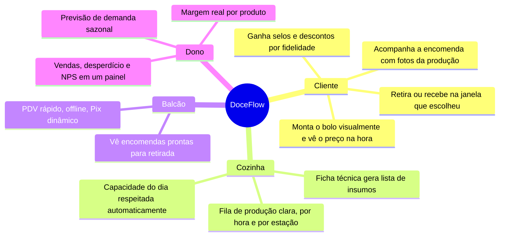
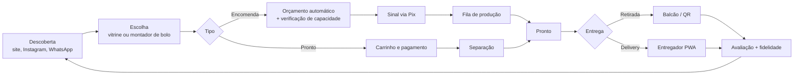

# 01 — Visão e Modelo de Negócio

> **Produto:** *DoceFlow* (nome provisório) — plataforma omnicanal para docerias que vendem **doces prontos** (pronta entrega) e **doces sob encomenda** (bolos, kits de festa, doces finos, corporativo).
>
> **Canais:** Web responsiva, PWA mobile (cliente e entregador) e PWA desktop (balcão/PDV, cozinha/KDS, gestão). Um único código-base front-end, instalável, com funcionamento offline nos pontos críticos.

---

## 1. Problema

| Dor atual da doceria                                     | Consequência                                              |
| -------------------------------------------------------- | --------------------------------------------------------- |
| Encomendas anotadas em caderno / WhatsApp solto          | Erros de data, sabores trocados, pedidos esquecidos       |
| Não sabe quantas encomendas a cozinha aguenta por dia    | Aceita demais (atrasa) ou de menos (perde receita)        |
| Doces prontos vencem na vitrine                          | Desperdício e margem corroída                             |
| Preço "no olho"                                          | Não sabe se o bolo deu lucro                              |
| Cliente liga para saber "já está pronto?"                | Atendente parado no telefone, cliente ansioso             |
| Promoção genérica                                        | Cliente fiel não é reconhecido, aniversário passa em branco |

## 2. Proposta de valor

## 3. Linhas de negócio

| Linha                      | Descrição                                                                 | Modelo de receita                         |
| -------------------------- | ------------------------------------------------------------------------- | ----------------------------------------- |
| **Pronta entrega**         | Brigadeiros, bolos de pote, fatias, cookies, tortas expostas na vitrine   | Venda unitária, combos, "últimas horas"   |
| **Sob encomenda**          | Bolos decorados, kits festa (cento de docinhos), doces finos, bolo de casamento | Orçamento + sinal (50 %) + saldo        |
| **Assinatura**             | "Clube do Brigadeiro": caixa mensal de doces (recorrência)                | Mensalidade                               |
| **Corporativo (B2B)**      | Café da manhã empresarial, brindes, eventos recorrentes                   | Faturamento mensal, contrato              |
| **Sazonal / pré-venda**    | Páscoa, Dia das Mães, Festa Junina, Natal                                 | Pré-venda com entrega agendada            |

## 4. Fluxo de valor (ponta a ponta)

## 5. Modelo de negócio (Canvas resumido)

| Bloco                  | Conteúdo                                                                                       |
| ---------------------- | ---------------------------------------------------------------------------------------------- |
| **Segmentos**          | Consumidor final (aniversários, presentes, "doce do dia"); organizadores de eventos; empresas  |
| **Proposta de valor**  | Comprar doce é fácil e transparente; produzir doce é previsível e lucrativo                    |
| **Canais**             | Web/PWA, WhatsApp (link de orçamento), balcão, Instagram (link na bio), quiosque               |
| **Relacionamento**     | Fidelidade gamificada, notificações de status, aniversário lembrado, assinatura                |
| **Receitas**           | Venda direta, sinal de encomendas, assinaturas, B2B, taxa de entrega                           |
| **Recursos-chave**     | Receitas (fichas técnicas), capacidade da cozinha, dados de clientes                           |
| **Atividades-chave**   | Produção, atendimento, logística de última milha, marketing sazonal                            |
| **Parceiros**          | Gateway Pix/cartão, apps de entrega, fornecedores de insumos, WhatsApp Business API            |
| **Custos**             | Insumos, equipe, embalagens, gateway, infraestrutura                                           |

## 6. Objetivos de negócio e KPIs (North Star)

**North Star:** *Receita por hora de forno* — mede ao mesmo tempo preço, mix e capacidade.

| Objetivo                               | KPI                                        | Meta ano 1 |
| -------------------------------------- | ------------------------------------------ | ---------- |
| Reduzir desperdício de pronta entrega  | % de itens vencidos vs. produzidos         | < 5 %      |
| Encher a cozinha sem atrasar           | Ocupação média da capacidade / atrasos     | 85 % / < 2 % |
| Vender mais por cliente                | Ticket médio, itens por pedido             | +20 %      |
| Fidelizar                              | % pedidos de clientes recorrentes          | > 45 %     |
| Encantar                               | NPS pós-entrega                            | > 70       |
| Margem real conhecida                  | % produtos com ficha técnica custeada      | 100 %      |

## 7. Princípios de produto

1. **Capacidade é a moeda** — nada entra na agenda sem slot de produção disponível.
2. **Preço nasce da ficha técnica** — todo item tem custo, margem e preço sugerido.
3. **Zero ligação "já está pronto?"** — o status chega ao cliente antes de ele perguntar.
4. **Funciona sem internet no balcão e na cozinha** — sincroniza quando voltar.
5. **Um código, três telas** — mobile, desktop e web com o mesmo PWA, layouts adaptativos.
