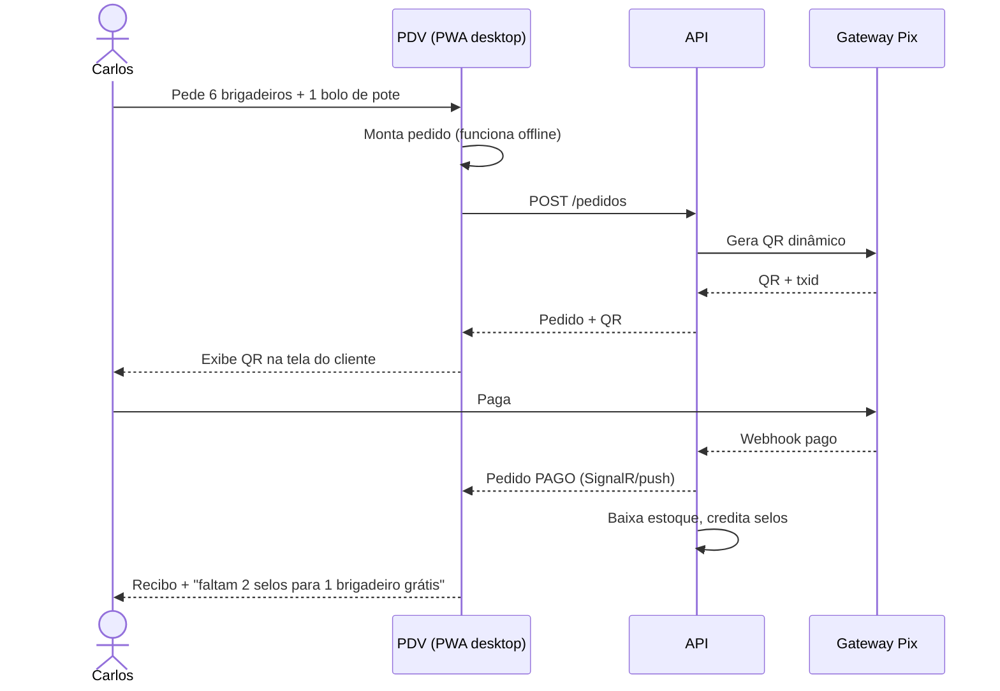
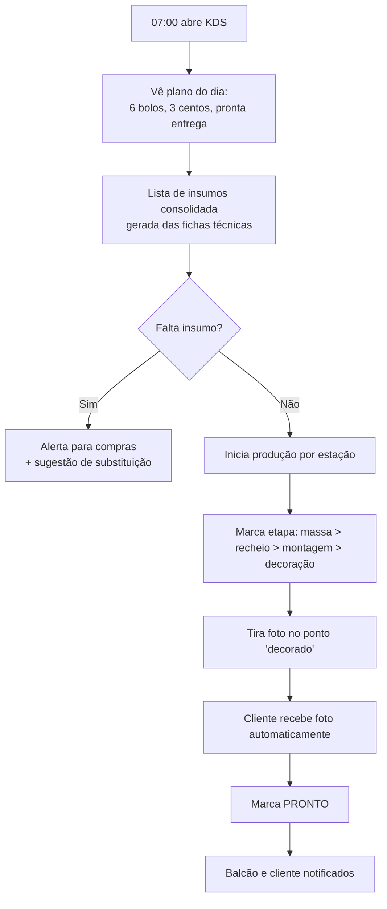
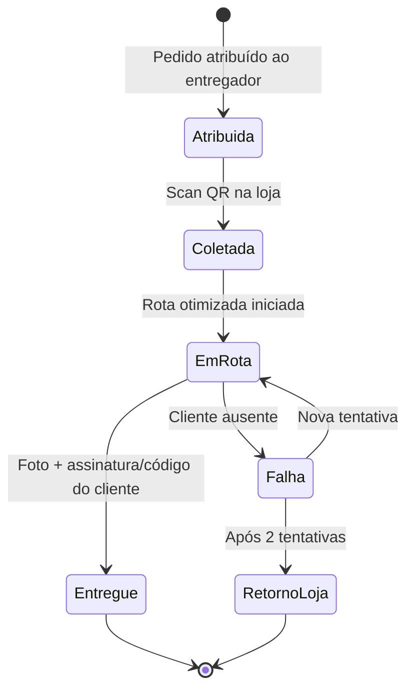

# 02 — Personas e Jornadas

## 1. Personas

| Persona                         | Perfil                                                         | Objetivo principal                               | Dispositivo típico            |
| ------------------------------- | -------------------------------------------------------------- | ------------------------------------------------ | ----------------------------- |
| **Ana, cliente final**          | 32 anos, mãe, organiza aniversário do filho                    | Encomendar bolo temático sem erro e sem estresse | Celular (PWA mobile)          |
| **Carlos, cliente de passagem** | Trabalha perto, compra "doce do dia"                           | Pegar rápido, pagar com Pix, acumular pontos     | Celular / balcão              |
| **Fernanda, RH corporativo**    | Encomenda café da manhã todo mês                               | Repetir pedido, receber nota, faturar mensal     | Desktop web                   |
| **Bia, atendente de balcão**    | Opera PDV e retiradas                                          | Atender em segundos, nunca perder venda          | Tablet/desktop PWA (PDV)      |
| **Chef Léo, confeiteiro**       | Chefia a cozinha                                               | Saber o que produzir, quando e com qual insumo   | Tablet PWA (KDS) na cozinha   |
| **Dona Rosa, proprietária**     | Decide preço, compras, promoções                               | Ver lucro, desperdício e demanda futura          | Desktop PWA / celular         |
| **Tiago, entregador**           | Entrega bolos frágeis                                          | Rota, confirmação com foto, sem ligar pra loja   | Celular (PWA offline)         |

## 2. Jornada — Encomenda de bolo (Ana)

```mermaid
journey
    title Encomenda de bolo decorado
    section Descoberta
      Vê bolo no Instagram e clica no link: 4: Ana
      Abre o montador de bolo no PWA: 5: Ana
    section Configuração
      Escolhe tamanho, massa, recheio, cobertura: 5: Ana
      Vê preço atualizar em tempo real: 5: Ana
      Sobe foto de referência e mensagem: 4: Ana
    section Agendamento
      Escolhe data; sistema mostra só dias com capacidade: 5: Ana, Sistema
      Escolhe retirada 15h ou entrega: 4: Ana
    section Pagamento
      Paga sinal de 50 % via Pix: 5: Ana
      Recebe confirmação e card compartilhável: 5: Ana
    section Produção
      Recebe foto do bolo em produção: 5: Ana, Chef Léo
      Recebe "pronto para retirada" com QR: 5: Ana
    section Entrega
      Apresenta QR no balcão, paga saldo: 5: Ana, Bia
      Avalia com foto e ganha selo: 5: Ana
```

## 3. Jornada — Compra rápida no balcão (Carlos)



## 4. Jornada — Dia da cozinha (Chef Léo)



## 5. Jornada — Entrega (Tiago)



## 6. Mapa de permissões (RBAC)

| Capacidade                          | Cliente | Atendente | Confeiteiro | Entregador | Gerente | Admin |
| ----------------------------------- | :-----: | :-------: | :---------: | :--------: | :-----: | :---: |
| Comprar / encomendar                |    ✔    |     ✔     |             |            |    ✔    |   ✔   |
| Operar PDV                          |         |     ✔     |             |            |    ✔    |   ✔   |
| Ver e mover fila de produção (KDS)  |         |           |      ✔      |            |    ✔    |   ✔   |
| Aprovar orçamento manual            |         |     ✔     |             |            |    ✔    |   ✔   |
| Editar catálogo e fichas técnicas   |         |           |      ✔      |            |    ✔    |   ✔   |
| Ajustar capacidade de produção      |         |           |      ✔      |            |    ✔    |   ✔   |
| Entregas                            |         |           |             |     ✔      |    ✔    |   ✔   |
| Relatórios financeiros              |         |           |             |            |    ✔    |   ✔   |
| Usuários, integrações, configurações|         |           |             |            |         |   ✔   |
