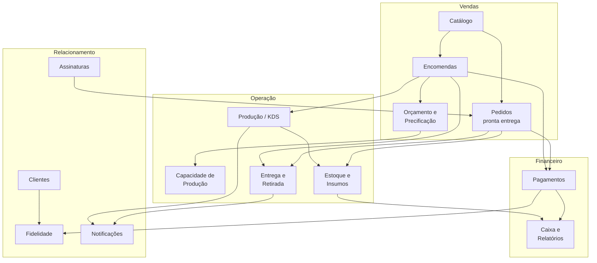
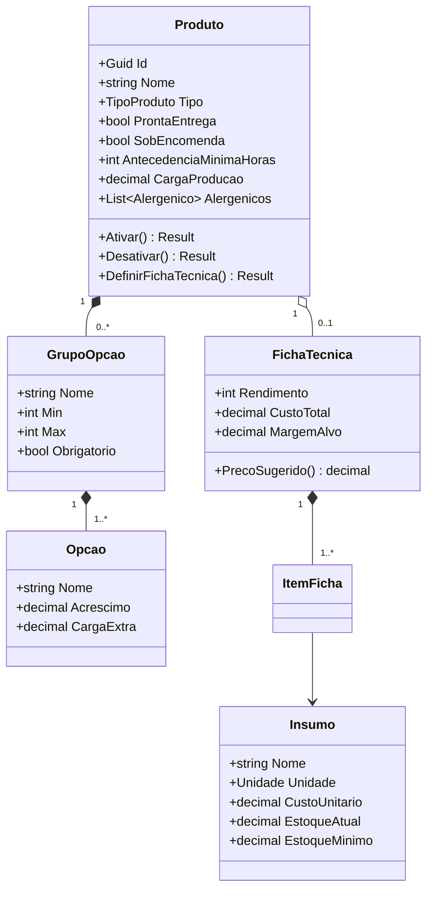
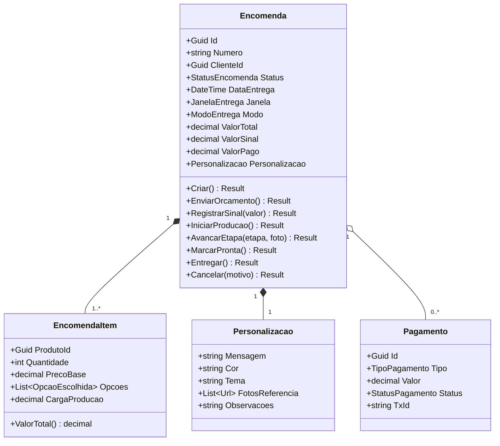
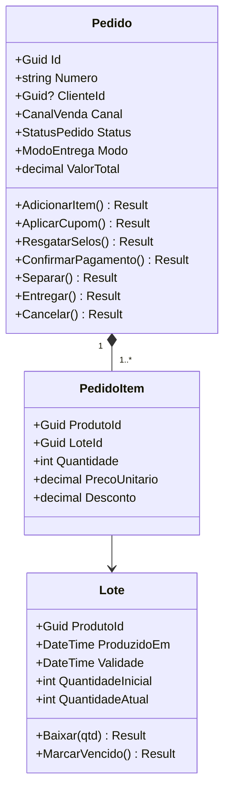
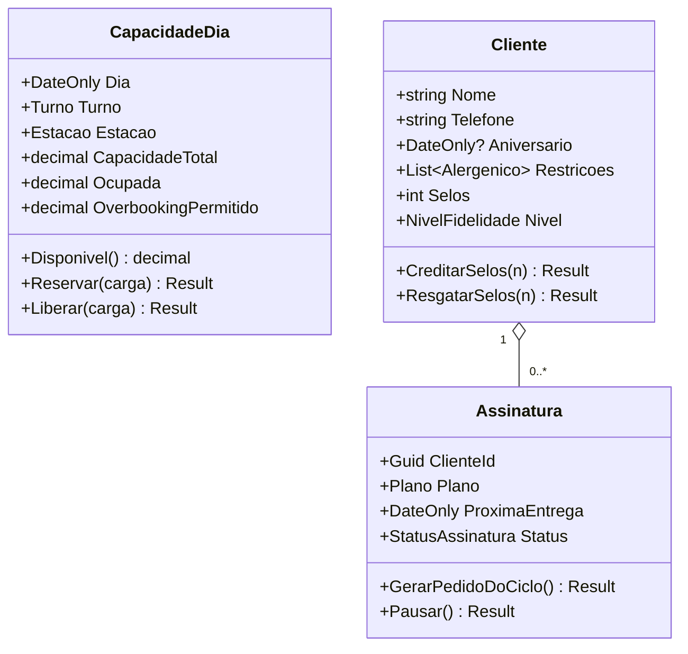
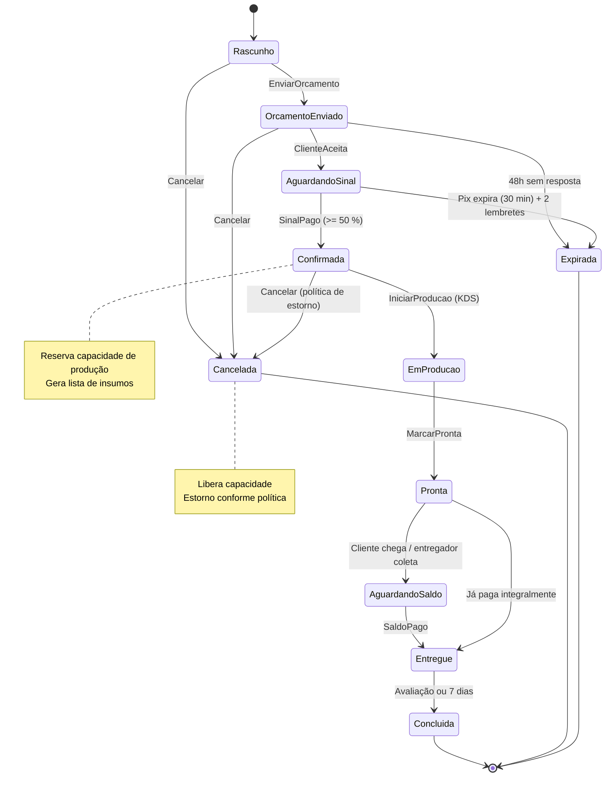
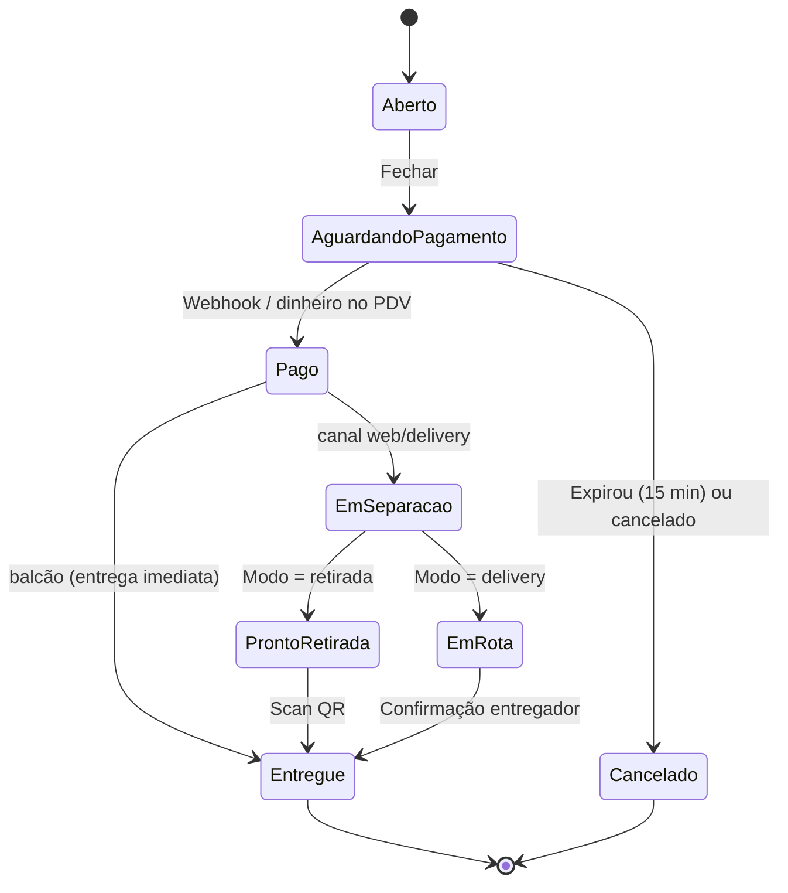
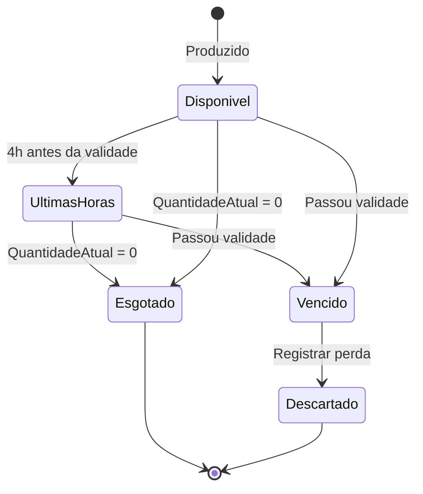

# 03 — Domínio e Regras de Negócio

> Modelagem orientada a DDD: contextos delimitados, agregados, máquinas de estado, invariantes e eventos de domínio. Toda regra aqui vira método de entidade que retorna `Result` (ver `ESPECIFICACOES-TECNICAS.md` §14).

---

## 1. Contextos delimitados

| Contexto                 | Responsabilidade                                                                  | Tipo             |
| ------------------------ | --------------------------------------------------------------------------------- | ---------------- |
| Catálogo                 | Produtos, variações, opções de personalização, alergênicos, fichas técnicas       | Core             |
| Pedidos                  | Venda de itens prontos (balcão, web, delivery)                                    | Core             |
| Encomendas               | Pedido sob encomenda com workflow, sinal, personalização e agendamento            | **Core (diferencial)** |
| Orçamento e Precificação | Cálculo de preço por opções, regras de margem, sugestão de preço                  | Core             |
| Capacidade de Produção   | Mapa de ocupação da cozinha por dia/turno/estação; overbooking controlado         | **Core (diferencial)** |
| Produção / KDS           | Fila, etapas, fotos, checklists                                                   | Supporting       |
| Estoque e Insumos        | Produtos acabados (validade), insumos (baixa por ficha técnica), compras          | Supporting       |
| Entrega e Retirada       | Janelas, rotas, retirada por QR                                                   | Supporting       |
| Clientes e Fidelidade    | Perfil, aniversário, selos, níveis, assinaturas                                   | Supporting       |
| Pagamentos               | Pix dinâmico, cartão, dinheiro, estorno, conciliação                              | Generic (gateway)|
| Notificações             | WhatsApp, push, e-mail                                                            | Generic          |
| Caixa e Relatórios       | Abertura/fechamento de caixa, DRE simplificado, desperdício                       | Supporting       |

## 2. Agregados principais

## 3. Máquinas de estado

### 3.1 Encomenda

### 3.2 Pedido (pronta entrega)

### 3.3 Lote de produto pronto

## 4. Regras de negócio (invariantes)

### 4.1 Catálogo e precificação

| #     | Regra                                                                                                              | Onde vive                     |
| ----- | ------------------------------------------------------------------------------------------------------------------ | ----------------------------- |
| RN-01 | Produto sob encomenda tem `AntecedenciaMinimaHoras` (bolo simples 24h, decorado 48h, casamento 7 dias)             | `Produto`                     |
| RN-02 | Preço de item = preço base + soma dos acréscimos das opções × quantidade                                           | `EncomendaItem.ValorTotal()`  |
| RN-03 | Grupo de opção respeita `Min`/`Max` (ex.: recheio: min 1, max 2)                                                   | `EncomendaItem.Create`        |
| RN-04 | Preço sugerido = custo da ficha técnica ÷ (1 − margem alvo); alerta se preço de venda < custo × 1,3                | `FichaTecnica.PrecoSugerido`  |
| RN-05 | Produto com alergênico que conflita com restrição do cliente exige confirmação explícita                           | `Specification` + UI          |
| RN-06 | Desconto progressivo em pronta entrega por quantidade (≥ 10 un: 10 %, ≥ 50: 15 %, ≥ 100: 20 %)                     | `Strategy` de desconto        |

### 4.2 Encomendas

| #     | Regra                                                                                                              | Onde vive                        |
| ----- | ------------------------------------------------------------------------------------------------------------------ | -------------------------------- |
| RN-10 | Data de entrega ≥ agora + maior antecedência entre os itens                                                        | `Encomenda.Criar`                |
| RN-11 | Encomenda só é confirmada com sinal ≥ 50 % do total (configurável por loja)                                        | `Encomenda.RegistrarSinal`       |
| RN-12 | Confirmar reserva `CargaProducao` na `CapacidadeDia`; sem capacidade → sugerir próximos 3 dias/turnos disponíveis  | Handler + `CapacidadeDia.Reservar` |
| RN-13 | Orçamento expira em 48h; sinal Pix expira em 30 min com 2 lembretes automáticos                                    | Job + estado                     |
| RN-14 | Cancelamento: > 72h antes = estorno 100 %; 24–72h = 50 %; < 24h = sem estorno (produção iniciada)                  | `Strategy` de estorno            |
| RN-15 | Encomenda em produção não pode ter itens alterados; apenas mensagem/observação                                     | `Encomenda.AlterarPersonalizacao`|
| RN-16 | Toda etapa de produção pode anexar foto; etapa "decorado" dispara foto ao cliente                                  | `Encomenda.AvancarEtapa`         |
| RN-17 | Entrega só com saldo quitado, exceto cliente B2B com crédito aprovado                                              | `Specification` `EncomendaEntregavel` |

### 4.3 Capacidade de produção

| #     | Regra                                                                                                              |
| ----- | ------------------------------------------------------------------------------------------------------------------ |
| RN-20 | Capacidade é medida em "pontos de carga" por dia, turno e estação (forno, confeitagem, montagem)                   |
| RN-21 | Cada produto/opção tem carga (ex.: bolo 2 kg = 6 pts; cento de brigadeiro = 3 pts; flores de açúcar = +4 pts)      |
| RN-22 | Overbooking permitido até 10 % apenas com aprovação do gerente                                                     |
| RN-23 | Feriados e folgas zeram capacidade; capacidade recorrente por dia da semana é configurável                         |
| RN-24 | Pronta entrega reserva uma fatia fixa diária (ex.: 30 %) que encomendas não podem invadir                          |

### 4.4 Estoque

| #     | Regra                                                                                                              |
| ----- | ------------------------------------------------------------------------------------------------------------------ |
| RN-30 | Baixa de produto pronto é FEFO (first-expire-first-out) por lote                                                   |
| RN-31 | 4h antes da validade o lote entra em "Últimas horas" com desconto progressivo (20 % → 40 %)                        |
| RN-32 | Encomenda confirmada reserva insumos por ficha técnica; insumo abaixo do mínimo gera alerta de compra              |
| RN-33 | Vencimento gera registro de perda com custo (alimenta relatório de desperdício)                                    |

### 4.5 Fidelidade e assinatura

| #     | Regra                                                                                                              |
| ----- | ------------------------------------------------------------------------------------------------------------------ |
| RN-40 | 1 selo a cada R$ 10 pagos; 10 selos = R$ 10 de crédito; selos expiram em 180 dias                                  |
| RN-41 | Níveis: Bronze (0), Prata (R$ 500/ano), Ouro (R$ 1.500/ano) — Ouro tem prioridade de capacidade e frete grátis     |
| RN-42 | Aniversário do cliente: cupom automático 7 dias antes                                                              |
| RN-43 | Assinatura gera pedido automaticamente D-2 da entrega; falha de pagamento → 3 tentativas → pausa                   |

## 5. Eventos de domínio

| Evento                            | Disparado por                     | Consumidores                                                |
| --------------------------------- | --------------------------------- | ----------------------------------------------------------- |
| `EncomendaCriadaEvent`            | `Encomenda.Criar`                 | Notificação (orçamento), analytics                          |
| `EncomendaConfirmadaEvent`        | `RegistrarSinal` (atinge 50 %)    | Capacidade (reservar), Estoque (reservar insumos), KDS, Notificação |
| `EncomendaEtapaAvancadaEvent`     | `AvancarEtapa`                    | Notificação com foto, timeline do cliente                   |
| `EncomendaProntaEvent`            | `MarcarPronta`                    | Notificação (QR retirada), Entrega (atribuir)               |
| `EncomendaCanceladaEvent`         | `Cancelar`                        | Capacidade (liberar), Pagamentos (estorno), Notificação     |
| `PedidoPagoEvent`                 | `ConfirmarPagamento`              | Estoque (baixa FEFO), Fidelidade (selos), Caixa             |
| `PedidoEntregueEvent`             | `Entregar`                        | Notificação (NPS em 2h), Fidelidade                         |
| `LoteEntrandoEmUltimasHorasEvent` | Job de validade                   | Catálogo (preço dinâmico), Notificação push geolocalizada   |
| `LoteVencidoEvent`                | Job de validade                   | Estoque (perda), Relatórios                                 |
| `InsumoAbaixoDoMinimoEvent`       | Baixa de insumo                   | Compras (alerta), Catálogo (desativar opção se crítico)     |
| `PagamentoConfirmadoEvent`        | Webhook gateway                   | Pedido/Encomenda (transição), Caixa                         |
| `CapacidadeEsgotadaEvent`         | `CapacidadeDia.Reservar`          | Catálogo (bloqueia data no calendário), Gerente (alerta)    |
| `ClienteSubiuDeNivelEvent`        | `Cliente.CreditarSelos`           | Notificação (parabéns), Marketing                           |

## 6. Specifications e Strategies previstas

| Padrão        | Nome                                   | Pergunta / variação                                                   |
| ------------- | -------------------------------------- | --------------------------------------------------------------------- |
| Specification | `EncomendaCancelavelSpecification`     | Status permite e não passou do limite?                                |
| Specification | `EncomendaEntregavelSpecification`     | Saldo quitado ou cliente B2B com crédito?                             |
| Specification | `ProdutoCompativelComRestricoesSpec`   | Produto não contém alergênico restrito pelo cliente?                  |
| Specification | `ClienteElegivelPrioridadeSpec`        | Nível Ouro ou B2B ativo?                                              |
| Strategy      | `IPoliticaEstornoStrategy`             | Por antecedência do cancelamento (100 % / 50 % / 0 %)                 |
| Strategy      | `IDescontoStrategy`                    | Por quantidade, por "últimas horas", por cupom, por nível             |
| Strategy      | `ICargaProducaoStrategy`               | Por tipo de produto (bolo, docinho, torta) → pontos de carga          |
| Strategy      | `ICanalNotificacaoStrategy`            | WhatsApp, push, e-mail, SMS (fallback em cadeia)                      |
| Strategy      | `IImpactoCapacidadeStrategy`           | Confirmar/Cancelar/Reagendar → delta no mapa de capacidade (análogo ao `IImpactStrategy` da spec) |
