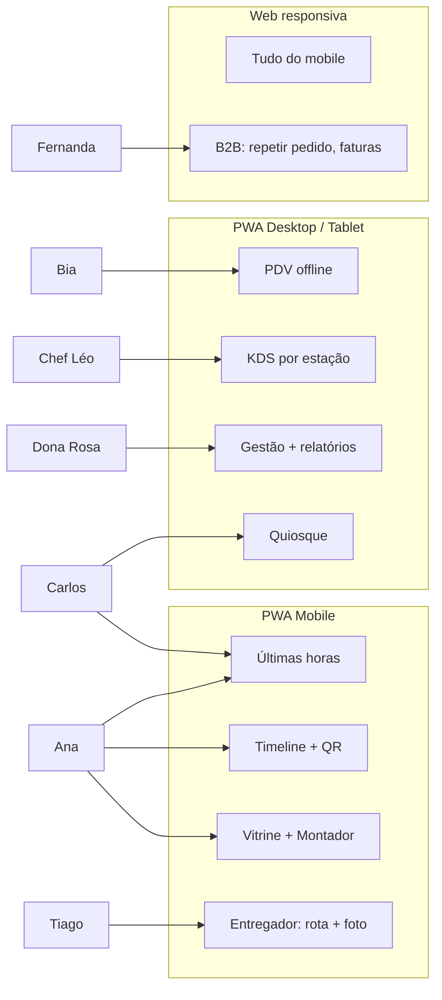

# 04 — Catálogo de Features

> Priorização MoSCoW. **M** = Must (MVP), **S** = Should (fase 2), **C** = Could (fase 3), **W** = Won't (agora).
> Features marcadas com 🚀 são as apostas **disruptivas** — o que diferencia a doceria da concorrência.

---

## 1. Vitrine e compra (cliente)

| ID    | Feature                                                   | Prio | Descrição                                                                                                       |
| ----- | --------------------------------------------------------- | :--: | --------------------------------------------------------------------------------------------------------------- |
| F-101 | Vitrine responsiva com filtros                            |  M   | Categorias, busca, filtros dietéticos (sem glúten, lactose, vegano, diet), alergênicos visíveis                  |
| F-102 | Carrinho e checkout em 3 toques                           |  M   | Pix dinâmico, cartão, retirada ou entrega; login opcional (telefone + OTP)                                       |
| F-103 | 🚀 **Montador de bolo visual**                            |  M   | Escolhe tamanho, massa, recheio, cobertura, tema, mensagem; preview ilustrado em camadas e **preço em tempo real** |
| F-104 | 🚀 **Calendário de capacidade**                           |  M   | Cliente só vê datas/turnos com capacidade real; sugere alternativas quando lotado                                |
| F-105 | Upload de foto de referência + observações                |  M   | Anexos na personalização; confeiteiro vê no KDS                                                                   |
| F-106 | Timeline da encomenda                                     |  M   | Status + fotos de produção; link público sem login (token)                                                       |
| F-107 | Retirada por QR Code                                      |  M   | QR no app; balcão escaneia e libera                                                                              |
| F-108 | 🚀 **"Últimas horas" (anti-desperdício)**                 |  S   | Vitrine de lotes perto da validade com desconto progressivo; push geolocalizado para quem está perto              |
| F-109 | 🚀 **Calculadora de festa**                               |  S   | Nº de convidados + perfil (infantil/adulto) → sugestão de quantidades e kit; IA ajusta por orçamento              |
| F-110 | 🚀 **Vaquinha do bolo**                                   |  C   | Link para amigos dividirem o valor; encomenda confirma quando atinge o sinal                                     |
| F-111 | 🚀 **Assinatura "Clube do Brigadeiro"**                   |  S   | Caixa mensal com curadoria; pausar, trocar sabores, presentear                                                   |
| F-112 | Pré-venda sazonal                                         |  S   | Páscoa, Mães, Natal com entrega agendada e capacidade própria                                                     |
| F-113 | Repetir pedido / favoritos                                |  S   | Um toque para repetir o último kit corporativo                                                                    |
| F-114 | 🚀 **Assistente de orçamento por WhatsApp (IA)**          |  C   | Cliente descreve a festa em texto/áudio; assistente monta rascunho de encomenda e envia link de aceite            |
| F-115 | Avaliação com foto + NPS                                  |  M   | Pós-entrega; fotos autorizadas viram galeria social na vitrine                                                    |
| F-116 | Lista de presentes / cartão-presente digital              |  C   | Vale-doce com QR                                                                                                  |

## 2. Balcão / PDV (PWA desktop ou tablet)

| ID    | Feature                                   | Prio | Descrição                                                                                     |
| ----- | ----------------------------------------- | :--: | --------------------------------------------------------------------------------------------- |
| F-201 | 🚀 **PDV offline-first**                  |  M   | Vende sem internet; fila de sincronização; Pix gerado quando reconectar ou dinheiro/cartão off |
| F-202 | Pix QR dinâmico com confirmação em tela   |  M   | Tela do cliente mostra QR; confirmação automática via webhook                                 |
| F-203 | Retiradas do dia                          |  M   | Lista de encomendas prontas, scanner de QR, cobrança do saldo                                 |
| F-204 | Abertura/fechamento de caixa              |  M   | Sangria, suprimento, conferência                                                               |
| F-205 | Identificar cliente por telefone          |  M   | Credita selos, aplica nível, mostra restrições alimentares                                     |
| F-206 | Venda por peso / fatia                    |  S   | Integração com balança (Web Serial API) para tortas e bolos por kg                            |
| F-207 | 🚀 **Quiosque de autoatendimento**        |  C   | Mesmo PWA em modo quiosque (tela cheia, sem login)                                            |
| F-208 | Impressão de etiquetas e cupom            |  S   | Etiqueta de validade por lote; cupom não fiscal; NFC-e via integrador                         |

## 3. Cozinha / KDS (PWA tablet)

| ID    | Feature                                           | Prio | Descrição                                                                                             |
| ----- | ------------------------------------------------- | :--: | ----------------------------------------------------------------------------------------------------- |
| F-301 | 🚀 **Fila de produção por estação e horário**     |  M   | Colunas: a fazer / em produção / pronto; ordenado por hora de entrega; cores por urgência              |
| F-302 | Etapas com checklist e foto                       |  M   | Massa → recheio → montagem → decoração; foto na etapa dispara notificação ao cliente                   |
| F-303 | 🚀 **Plano do dia + lista de insumos**            |  M   | Consolida fichas técnicas das encomendas e metas de pronta entrega; lista de compras                   |
| F-304 | Registro de produção de pronta entrega (lote)     |  M   | Gera lote com validade; imprime etiqueta                                                               |
| F-305 | Capacidade do dia editável                        |  M   | Confeiteiro ajusta pontos por estação; bloqueia dias                                                   |
| F-306 | Modo mãos ocupadas                                |  C   | Botões grandes, comandos por voz "próxima etapa"                                                       |
| F-307 | Registro de perda / sobra                         |  S   | Motivo (queimou, caiu, venceu); alimenta desperdício                                                   |

## 4. Entrega (PWA mobile entregador)

| ID    | Feature                             | Prio | Descrição                                                                           |
| ----- | ----------------------------------- | :--: | ----------------------------------------------------------------------------------- |
| F-401 | Janelas de entrega                  |  M   | Cliente escolhe janela de 2h; capacidade de entregas por janela                      |
| F-402 | Rota do dia e navegação             |  S   | Ordena paradas; abre no Maps                                                         |
| F-403 | Confirmação com foto + código       |  M   | Foto do bolo entregue; código de 4 dígitos do cliente                                 |
| F-404 | Integração com apps de entrega      |  C   | Lalamove/Loggi para bolos grandes                                                     |
| F-405 | 🚀 **Checklist de transporte**      |  S   | Alerta "bolo de 3 andares: usar caixa X, não inclinar"; QR na caixa                   |

## 5. Gestão (PWA desktop)

| ID    | Feature                                           | Prio | Descrição                                                                                             |
| ----- | ------------------------------------------------- | :--: | ----------------------------------------------------------------------------------------------------- |
| F-501 | Catálogo, opções e fichas técnicas                |  M   | CRUD com custo por insumo, rendimento, margem e **preço sugerido**                                     |
| F-502 | 🚀 **Painel de margem real**                      |  S   | Lucro por produto considerando perdas e opções; alerta de produto "no vermelho"                       |
| F-503 | Estoque de insumos e compras                      |  M   | Entradas, mínimo, alerta, sugestão de pedido ao fornecedor                                             |
| F-504 | 🚀 **Previsão de demanda sazonal**                |  C   | Modelo simples (média móvel + sazonalidade) sugere produção e compras para Páscoa/Natal                |
| F-505 | Relatórios: vendas, desperdício, ocupação, NPS    |  M   | Exportáveis; comparação com período anterior                                                           |
| F-506 | Campanhas e cupons                                |  S   | Segmentos (inativos 60 dias, aniversariantes, Ouro); disparo WhatsApp/push                             |
| F-507 | Clientes B2B                                      |  S   | Crédito aprovado, faturamento mensal, pedidos recorrentes                                              |
| F-508 | Multi-loja                                        |  W   | Fora do escopo inicial; modelo já prevê `LojaId`                                                       |

## 6. Plataforma / transversal

| ID    | Feature                                  | Prio | Descrição                                                                                       |
| ----- | ---------------------------------------- | :--: | ----------------------------------------------------------------------------------------------- |
| F-601 | PWA instalável (mobile + desktop)        |  M   | Manifest, service worker, ícones, splash; modo standalone                                        |
| F-602 | Notificações push + WhatsApp + e-mail    |  M   | Cadeia de fallback; preferências por cliente                                                     |
| F-603 | Autenticação                             |  M   | Cliente: telefone + OTP; equipe: e-mail/senha + JWT + roles                                      |
| F-604 | Tempo real                               |  M   | SignalR para PDV/KDS (status de pagamento, nova encomenda)                                       |
| F-605 | Auditoria                                | S    | Quem mudou preço/status/capacidade e quando                                                      |
| F-606 | LGPD                                     | M    | Consentimento, exportação e exclusão de dados do cliente                                         |
| F-607 | Acessibilidade e i18n                    | S    | WCAG AA, pt-BR primeiro, estrutura pronta para en/es                                             |

## 7. Mapa de features por persona e dispositivo

## 8. Ideias para o backlog de inovação (não priorizadas)

- **Degustação por assinatura corporativa**: empresas recebem amostras mensais e aprovam o cardápio do evento no app.
- **Etiqueta NFC na caixa**: cliente encosta o celular e vê ingredientes, alergênicos e vídeo do confeiteiro.
- **Marketplace de confeiteiros parceiros**: picos de demanda (Natal) alocados para parceiros homologados usando o mesmo mapa de capacidade.
- **Realidade aumentada**: ver o bolo em tamanho real na mesa antes de encomendar.
- **Receita em cadeia (upsell inteligente)**: "quem encomendou este bolo também levou 30 brigadeiros" com base nas combinações reais.
