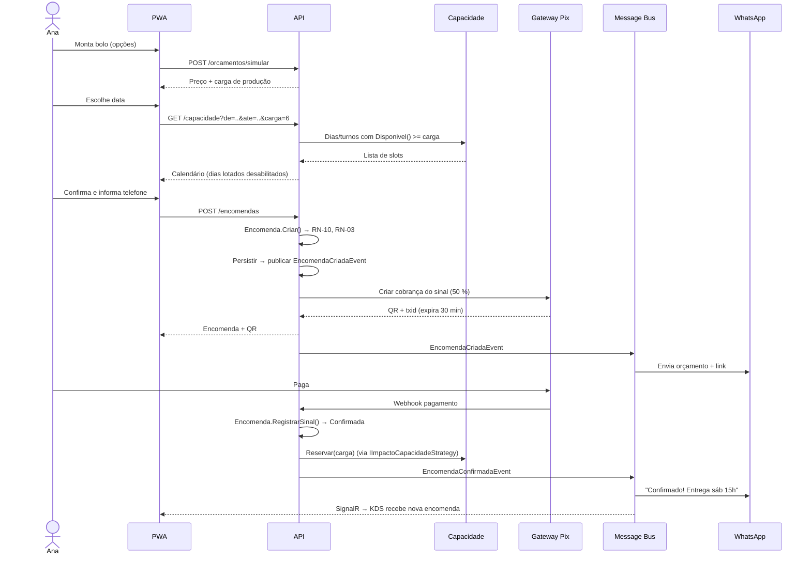
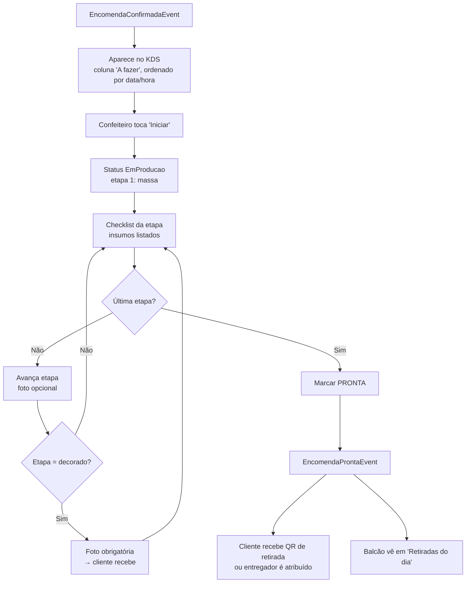
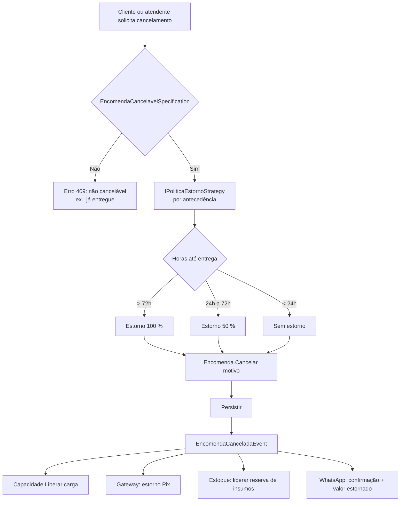
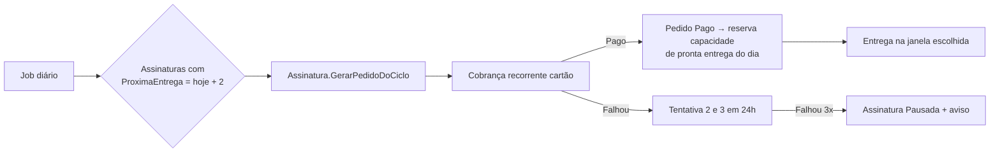
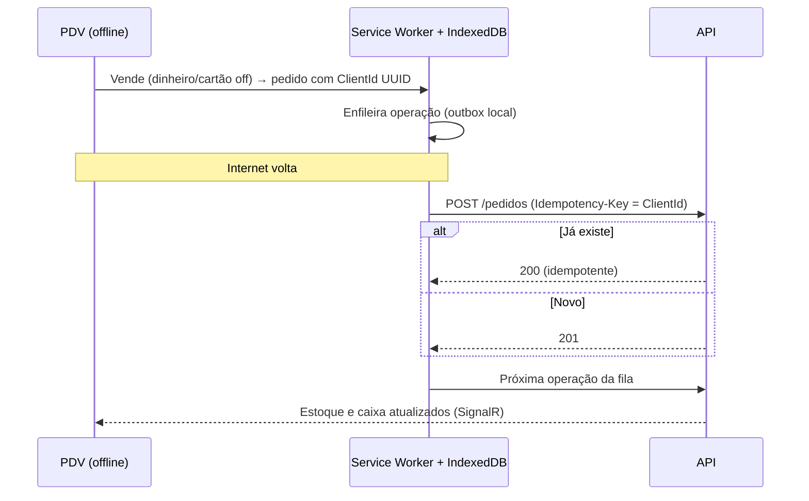
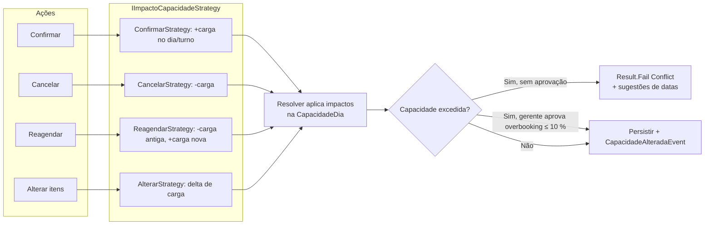

# 05 — Fluxos de Processo

> Fluxos ponta a ponta com os sistemas envolvidos. Nomes de endpoints e eventos seguem `06-arquitetura-tecnica.md`.

---

## 1. Encomenda: do montador ao sinal pago



## 2. Produção no KDS



## 3. Venda de pronta entrega com estoque por lote

```mermaid
sequenceDiagram
    participant PDV
    participant API
    participant Est as Estoque
    participant Fid as Fidelidade

    PDV->>API: POST /pedidos {itens, telefoneCliente}
    API->>Est: Verificar disponibilidade por produto (soma de lotes válidos)
    Est-->>API: OK
    API->>API: Pedido.Criar(); aplicar IDescontoStrategy
    API-->>PDV: Pedido AguardandoPagamento + QR Pix
    Note over PDV: Cliente paga
    API->>API: Pedido.ConfirmarPagamento() → Pago
    API->>Est: Baixar FEFO (lote mais próximo do vencimento primeiro)
    API->>Fid: Creditar selos (RN-40)
    Fid-->>API: ClienteSubiuDeNivelEvent? (se aplicável)
    API-->>PDV: Recibo + saldo de selos
```

## 4. Cancelamento e estorno



## 5. Ciclo de vida do lote e "Últimas horas"

```mermaid
sequenceDiagram
    participant Job as Job de validade (a cada 15 min)
    participant API
    participant Cat as Catálogo
    participant Push

    Job->>API: Lotes com validade - agora <= 4h e status Disponivel
    API->>API: Lote → UltimasHoras
    API->>Cat: Preço dinâmico: -20 % agora, -40 % faltando 1h
    API->>Push: "6 bolos de pote com 20 % off até 18h" (clientes num raio de 2 km, opt-in)
    Job->>API: Lotes vencidos
    API->>API: Lote → Vencido; registra perda com custo
    API-->>Job: LoteVencidoEvent → relatório de desperdício
```

## 6. Assinatura mensal



## 7. Sincronização offline do PDV



## 8. Capacidade: impacto por ação (reaproveitando o conceito de mapa de ocupação da spec)


