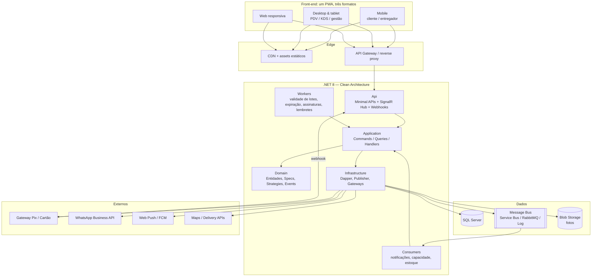
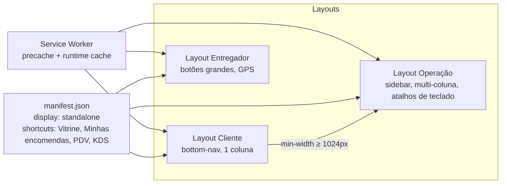

# 06 — Arquitetura Técnica

> Derivada de `../../ESPECIFICACOES-TECNICAS.md`. Esta seção diz **o que foi aproveitado, o que foi adaptado e o que foi descartado** para a doceria, e adiciona a camada front-end PWA que a especificação original não cobre.

---

## 1. Aderência à especificação técnica

| Seção da spec                              | Decisão      | Como se aplica à doceria                                                                                   |
| ------------------------------------------ | ------------ | ---------------------------------------------------------------------------------------------------------- |
| §1 Clean Architecture + CQRS sem Mediator  | ✅ Usar       | Mesma estrutura `Api / Application / Domain / Infrastructure / Common`                                      |
| §3 Dispatcher customizado                  | ✅ Usar       | Idêntico                                                                                                   |
| §5 Command + Handler + Validator no mesmo arquivo | ✅ Usar | Ex.: `Features/Encomendas/CreateEncomenda.cs`                                                              |
| §6 Azure Service Bus                       | 🔁 Adaptar   | Manter `IMessageBus`/`IEventPublisher`. Dev/CI = `LogEventPublisher`; produção = Service Bus **ou** RabbitMQ (ADR-004). Uso: notificações, jobs de capacidade, webhooks |
| §7 Registro manual de handlers + Keyed Services | ✅ Usar  | Keyed services para `IDescontoStrategy`, `IPoliticaEstornoStrategy`, `ICanalNotificacaoStrategy`          |
| §8 FluentValidation explícita no endpoint  | ✅ Usar       | Idêntico                                                                                                   |
| §9 Strategy + Resolver                     | ✅ Usar       | `IImpactoCapacidadeStrategy` substitui `IImpactStrategy<Reserva/Contrato>`; mesma ideia de mapa de ocupação |
| §10 Dapper + SQL Server                    | ✅ Usar       | Repositórios `sealed`, SQL constante, whitelist de ordenação                                               |
| §11 Minimal APIs versionadas               | ✅ Usar       | `/api/v1/...`                                                                                              |
| §12 FluentResults + `Errors.*`             | ✅ Usar       | Adicionar `Errors.CapacidadeIndisponivel` (409 com sugestões) e `Errors.Pagamento`                         |
| §14 Rich Domain + Domain Events            | ✅ Usar       | Base de todo o §4 de `03-dominio-e-regras-de-negocio.md`                                                   |
| §15 Publicação resiliente (Polly)          | ✅ Usar       | Idêntico; **acrescentar Outbox** para eventos financeiros (ADR-005)                                        |
| §16 Paginação e ordenação                  | ✅ Usar       | Listagens de pedidos, encomendas, clientes, lotes                                                          |
| §17 Middleware de exceções (RFC 7807)      | ✅ Usar       | Idêntico                                                                                                   |
| §18 Serilog, Health Checks, JWT            | ✅ Usar       | Health checks: SQL, broker (se configurado), gateway Pix; JWT com roles (`Cliente`, `Atendente`, ...)       |
| §19 Specification                          | ✅ Usar       | Specs listadas em `03-dominio...#6`                                                                        |
| §20 Testes (xUnit, NSubstitute, Bogus)     | ✅ Usar       | Idêntico; Bogus `pt_BR`                                                                                     |
| §21 ADRs                                   | ✅ Usar       | `docs/adr/`                                                                                                |
| §22 Docker multi-stage + compose           | ✅ Usar       | Acrescenta serviço `web` (PWA) e `rabbitmq` opcional                                                       |
| Domínio Reservas/Contratos/Disponibilidade | ❌ Descartar  | Específico de locação de veículos; só o **conceito** de mapa de ocupação é reaproveitado                   |
| `LojaId` de 4 chars / `GrupoId`            | ❌ Descartar  | Doceria é single-store no MVP; `LojaId` entra como `Guid` opcional para multi-loja futuro                  |

## 2. Visão de alto nível



## 3. Estrutura de pastas (back-end)

```
src/
├── Api/
│   ├── Endpoints/
│   │   ├── Catalogo/        ProdutosEndpoints.cs, FichasTecnicasEndpoints.cs
│   │   ├── Encomendas/      EncomendasEndpoints.cs, OrcamentosEndpoints.cs
│   │   ├── Pedidos/         PedidosEndpoints.cs
│   │   ├── Capacidade/      CapacidadeEndpoints.cs
│   │   ├── Producao/        ProducaoEndpoints.cs (KDS)
│   │   ├── Estoque/         LotesEndpoints.cs, InsumosEndpoints.cs
│   │   ├── Entregas/        EntregasEndpoints.cs
│   │   ├── Clientes/        ClientesEndpoints.cs, FidelidadeEndpoints.cs, AssinaturasEndpoints.cs
│   │   ├── Pagamentos/      PagamentosEndpoints.cs, WebhooksEndpoints.cs
│   │   ├── Relatorios/      RelatoriosEndpoints.cs
│   │   └── Auth/            AuthEndpoints.cs
│   ├── Hubs/                OperacaoHub.cs (SignalR: PDV, KDS, entregador)
│   ├── ServiceBus/          NotificacaoConsumer.cs, CapacidadeConsumer.cs, EstoqueConsumer.cs
│   ├── Workers/             ValidadeLotesWorker.cs, ExpiracaoWorker.cs, AssinaturasWorker.cs
│   ├── Middleware/          ExceptionHandlingMiddleware.cs, IdempotencyMiddleware.cs
│   └── Program.cs
├── Application/
│   ├── Abstractions/        ICommand, IQuery, Dispatcher, IMessageBus, IEventPublisher, Repositories/
│   ├── Common/              PagedQuery, PagedResult
│   ├── Features/
│   │   ├── Catalogo/        CreateProduto.cs, UpdateFichaTecnica.cs, GetVitrine.cs, ...
│   │   ├── Encomendas/      CreateEncomenda.cs, SimularOrcamento.cs, RegistrarSinal.cs, AvancarEtapa.cs, CancelarEncomenda.cs, GetTimeline.cs
│   │   ├── Pedidos/         CreatePedido.cs, ConfirmarPagamento.cs, GetPedidosPaged.cs
│   │   ├── Capacidade/      GetDisponibilidade.cs, AplicarImpacto.cs, UpdateCapacidadeDia.cs
│   │   ├── Estoque/         RegistrarLote.cs, BaixarFefo.cs, ProcessarValidade.cs
│   │   ├── Fidelidade/      CreditarSelos.cs, ResgatarSelos.cs
│   │   └── Notificacoes/    EnviarNotificacao.cs
│   └── DependencyInjection.cs
├── Domain/
│   ├── Entities/            Produto, Encomenda, Pedido, Lote, Insumo, CapacidadeDia, Cliente, Assinatura, Pagamento
│   ├── ValueObjects/        Dinheiro, JanelaEntrega, Personalizacao, CargaProducao, Telefone
│   ├── Enums/               StatusEncomenda, StatusPedido, ModoEntrega, Alergenico, Estacao, Turno
│   ├── Events/              EncomendaConfirmadaEvent, PedidoPagoEvent, LoteVencidoEvent, ...
│   ├── Specifications/      EncomendaCancelavelSpecification, ...
│   ├── Strategies/
│   │   ├── Capacidade/      IImpactoCapacidadeStrategy, ConfirmarStrategy, CancelarStrategy, ReagendarStrategy, ImpactoResolver
│   │   ├── Preco/           IDescontoStrategy, DescontoQuantidade, DescontoUltimasHoras, DescontoNivel
│   │   └── Estorno/         IPoliticaEstornoStrategy, EstornoPorAntecedencia
│   └── Services/            CalculadoraOrcamento, CalculadoraFesta
├── Infrastructure/
│   ├── Data/                SqlConnectionFactory, OrderByBuilder, Scripts/ (migrations SQL por versão)
│   ├── Repositories/
│   ├── Events/              ServiceBusEventPublisher, RabbitMqEventPublisher, LogEventPublisher, OutboxPublisher
│   ├── Gateways/            PixGateway (interface + impl), WhatsAppGateway, PushGateway, BlobStorage
│   └── DependencyInjection.cs
└── Common/                  Exceptions, HealthChecks, Logging, Security, Results

web/                          ← front-end PWA (ver §5)
tests/                        ← Unit / Integration / Functional (spec §20)
docs/                         ← este diretório + adr/
```

## 4. API (v1) — resumo dos endpoints

| Método | Rota                                     | Auth        | Descrição                                        |
| ------ | ---------------------------------------- | ----------- | ------------------------------------------------ |
| GET    | `/catalogo/vitrine`                      | pública     | Produtos ativos, lotes disponíveis, "últimas horas" |
| GET    | `/catalogo/produtos/{id}`                | pública     | Produto + grupos de opções                       |
| POST   | `/catalogo/produtos`                     | Gerente     | Criar produto                                    |
| PUT    | `/catalogo/produtos/{id}/ficha-tecnica`  | Confeiteiro | Ficha técnica (retorna custo e preço sugerido)   |
| POST   | `/orcamentos/simular`                    | pública     | Preço + carga para uma configuração              |
| POST   | `/orcamentos/calculadora-festa`          | pública     | Sugestão por nº de convidados                    |
| GET    | `/capacidade?de&ate&carga`               | pública     | Slots disponíveis                                |
| PUT    | `/capacidade/{dia}`                      | Confeiteiro | Ajustar capacidade/bloquear                      |
| POST   | `/encomendas`                            | Cliente     | Criar (retorna QR do sinal)                      |
| GET    | `/encomendas/{id}`                       | Cliente/Equipe | Detalhe                                       |
| GET    | `/encomendas/{id}/timeline?token=`       | pública     | Timeline pública com fotos                       |
| POST   | `/encomendas/{id}/cancelar`              | Cliente/Atendente | Aplica política de estorno                 |
| POST   | `/encomendas/{id}/reagendar`             | Atendente   | Reaplica capacidade                              |
| GET    | `/producao/fila?dia&estacao`             | Confeiteiro | KDS                                              |
| POST   | `/producao/{encomendaId}/iniciar`        | Confeiteiro | → EmProducao                                     |
| POST   | `/producao/{encomendaId}/etapas`         | Confeiteiro | Avança etapa (multipart com foto)                |
| POST   | `/producao/{encomendaId}/pronta`         | Confeiteiro | → Pronta                                         |
| GET    | `/producao/plano-do-dia`                 | Confeiteiro | Consolidado + lista de insumos                   |
| POST   | `/pedidos`                               | Cliente/PDV | Cria pedido (`Idempotency-Key` obrigatório no PDV) |
| POST   | `/pedidos/{id}/retirar`                  | Atendente   | Scan QR → Entregue                               |
| GET    | `/pedidos?page&size&order&status`        | Equipe      | Paginado                                         |
| POST   | `/estoque/lotes`                         | Confeiteiro | Registrar produção de pronta entrega             |
| POST   | `/estoque/lotes/{id}/perda`              | Confeiteiro | Registrar perda                                  |
| GET    | `/estoque/insumos?abaixoDoMinimo=true`   | Gerente     | Alertas de compra                                |
| POST   | `/entregas/{id}/coletar` / `/confirmar`  | Entregador  | Com foto + código                                |
| POST   | `/clientes/otp` / `/clientes/otp/validar`| pública     | Login por telefone                               |
| GET    | `/clientes/me/fidelidade`                | Cliente     | Selos, nível, histórico                          |
| POST   | `/assinaturas`                           | Cliente     | Criar assinatura                                 |
| POST   | `/webhooks/pix`                          | assinatura HMAC | Confirmação de pagamento                     |
| GET    | `/relatorios/vendas`, `/desperdicio`, `/ocupacao`, `/margem`, `/nps` | Gerente | Com período          |
| GET    | `/health/live` `/health/ready`           | pública     | Probes                                           |

Convenções: `ProblemDetails` para erros (spec §17); `409 Conflict` com `sugestoes[]` quando não há capacidade; enums como string; paginação `?page&size&order` (spec §16).

## 5. Front-end PWA

### 5.1 Stack

| Camada            | Escolha                                                | Motivo                                                                 |
| ----------------- | ------------------------------------------------------ | ---------------------------------------------------------------------- |
| Framework         | **React 18 + TypeScript + Vite**                       | Ecossistema PWA maduro, ótimo em mobile e desktop (ADR-006)            |
| PWA               | `vite-plugin-pwa` (Workbox)                            | Service worker, precache, estratégias de cache por rota                |
| Estado servidor   | TanStack Query                                         | Cache, retry, modo offline com `persistQueryClient`                    |
| Offline / outbox  | Dexie (IndexedDB)                                      | Fila de operações do PDV/KDS/entregador                                |
| UI                | Tailwind + Radix (ou shadcn/ui)                        | Responsivo, acessível, temas                                           |
| Tempo real        | `@microsoft/signalr`                                   | PDV e KDS                                                              |
| Formulários       | React Hook Form + Zod                                  | Mesmas regras do FluentValidation espelhadas                           |
| Roteamento        | React Router com *layouts por formato*                 | `/app` (cliente), `/pdv`, `/kds`, `/entrega`, `/admin`                 |
| Montador de bolo  | SVG em camadas (massa/recheio/cobertura/topo)          | Leve, sem WebGL; evolui para 3D depois                                 |

### 5.2 Um PWA, três formatos



| Requisito            | Mobile (cliente)                 | Desktop/tablet (PDV, KDS)                  | Entregador                        |
| -------------------- | -------------------------------- | ------------------------------------------ | --------------------------------- |
| Offline              | Vitrine em cache, timeline       | **Vendas e etapas enfileiradas (outbox)**  | Rota e confirmações enfileiradas  |
| Push                 | Status, últimas horas            | Nova encomenda, pagamento confirmado       | Nova entrega atribuída            |
| Hardware             | Câmera (foto referência), geoloc | Scanner QR (câmera), balança (Web Serial), impressora (WebUSB/ESC-POS) | Câmera, GPS |
| Instalação           | "Adicionar à tela inicial"       | Instalado como app de janela               | Idem mobile                       |

### 5.3 Estratégias de cache

| Recurso                       | Estratégia Workbox       |
| ----------------------------- | ------------------------ |
| Shell da aplicação            | Precache                 |
| `/catalogo/*`                 | Stale-while-revalidate   |
| Fotos de produtos             | Cache-first (30 dias)    |
| `/pedidos`, `/producao/*`     | Network-first + outbox   |
| `/capacidade`                 | Network-only (precisa ser atual) |

### 5.4 Idempotência e conflitos

- Toda escrita originada offline carrega `Idempotency-Key` (UUID gerado no cliente); o `IdempotencyMiddleware` guarda chave → resposta por 24h.
- Conflito de estoque na sincronização (vendeu offline o que já tinha acabado) gera `409` e o PDV mostra "ajuste manual necessário"; nunca falha em silêncio.

## 6. Tempo real, jobs e integrações

| Mecanismo            | Uso                                                                                              |
| -------------------- | ------------------------------------------------------------------------------------------------ |
| SignalR `OperacaoHub`| Grupos por papel: `pdv`, `kds`, `entregador:{id}`, `cliente:{id}`                                |
| Worker `ValidadeLotes` | A cada 15 min: últimas horas e vencidos                                                       |
| Worker `Expiracao`   | Orçamentos 48h, Pix 30 min, lembretes                                                            |
| Worker `Assinaturas` | Diário: gera pedidos D-2, cobra, pausa após 3 falhas                                             |
| Worker `Outbox`      | Publica eventos pendentes da tabela `Outbox` (ADR-005)                                           |
| Gateway Pix          | Interface `IPixGateway` (cobrança, estorno, consulta); impl. inicial: provedor com API Pix (ex.: Efí, Mercado Pago, Asaas) |
| WhatsApp             | `IWhatsAppGateway` com templates aprovados; fallback push → e-mail                               |
| Blob                 | Fotos de referência e de produção com URL assinada                                               |

## 7. Segurança e LGPD

- JWT com roles (spec §18.3); cliente autentica por telefone + OTP (sem senha).
- Timeline pública usa token opaco de 32 bytes, revogável.
- Webhook Pix validado por assinatura HMAC + idempotência por `txid`.
- Dados pessoais: consentimento registrado, endpoint de exportação e anonimização (`Cliente.Anonimizar()` preserva histórico financeiro).
- Fotos de clientes só na galeria pública com consentimento explícito.

## 8. Observabilidade

- Serilog JSON (spec §18.1) com `traceId`, `encomendaId`, `pedidoId` enriquecidos via `LogContext`.
- Métricas: ocupação de capacidade, tempo médio por etapa, taxa de sincronização offline, falhas de webhook.
- Health checks: `sqlserver`, `broker` (se configurado), `pix-gateway` (ping), `blob`.

## 9. Docker Compose (dev)

```yaml
services:
  api:      # .NET 8, ServiceBus vazio → LogEventPublisher
  web:      # Vite build servido por nginx, proxy /api → api
  db:       # SQL Server 2022
  rabbitmq: # opcional (profile: broker) — ativa RabbitMqEventPublisher
  azurite:  # emulador de blob para fotos
```
