# 07 — Modelo de Dados

> SQL Server, acesso via Dapper. Convenção `tbl{Entidade}` (spec §10). Enums gravados como `VARCHAR` (legível em consultas). Valores monetários `DECIMAL(12,2)`. Datas em UTC.

```mermaid
erDiagram
    tblClientes ||--o{ tblEncomendas : faz
    tblClientes ||--o{ tblPedidos : faz
    tblClientes ||--o{ tblAssinaturas : possui
    tblClientes ||--o{ tblMovimentosFidelidade : acumula

    tblProdutos ||--o{ tblGruposOpcao : tem
    tblGruposOpcao ||--o{ tblOpcoes : contem
    tblProdutos ||--o| tblFichasTecnicas : custeia
    tblFichasTecnicas ||--o{ tblItensFicha : usa
    tblInsumos ||--o{ tblItensFicha : compoe
    tblInsumos ||--o{ tblMovimentosInsumo : movimenta

    tblProdutos ||--o{ tblLotes : produz
    tblLotes ||--o{ tblPedidoItens : baixa

    tblEncomendas ||--|{ tblEncomendaItens : contem
    tblEncomendaItens ||--o{ tblEncomendaItemOpcoes : escolhe
    tblEncomendas ||--o{ tblEncomendaEtapas : registra
    tblEncomendas ||--o{ tblPagamentos : recebe
    tblEncomendas ||--o{ tblEntregas : gera
    tblEncomendas }o--|| tblCapacidadeDias : reserva

    tblPedidos ||--|{ tblPedidoItens : contem
    tblPedidos ||--o{ tblPagamentos : recebe
    tblPedidos ||--o{ tblEntregas : gera

    tblAssinaturas ||--o{ tblPedidos : gera

    tblClientes {
        uniqueidentifier Id PK
        varchar Nome
        varchar Telefone UK
        varchar Email
        date Aniversario
        varchar Restricoes "JSON array de alergênicos"
        int Selos
        varchar Nivel
        bit ConsentimentoMarketing
        datetime2 CriadoEm
        datetime2 AnonimizadoEm
    }

    tblProdutos {
        uniqueidentifier Id PK
        varchar Nome
        varchar Tipo
        varchar Descricao
        bit ProntaEntrega
        bit SobEncomenda
        int AntecedenciaMinimaHoras
        decimal CargaProducao
        varchar Estacao
        decimal PrecoBase
        varchar Alergenicos "JSON"
        varchar Tags "JSON: vegano, semGluten..."
        bit Ativo
    }

    tblGruposOpcao {
        uniqueidentifier Id PK
        uniqueidentifier ProdutoId FK
        varchar Nome
        int Min
        int Max
        int Ordem
    }

    tblOpcoes {
        uniqueidentifier Id PK
        uniqueidentifier GrupoOpcaoId FK
        varchar Nome
        decimal Acrescimo
        decimal CargaExtra
        varchar Alergenicos "JSON"
        bit Ativo
    }

    tblFichasTecnicas {
        uniqueidentifier Id PK
        uniqueidentifier ProdutoId FK
        int Rendimento
        decimal MargemAlvo
        decimal CustoTotal "calculado e cacheado"
        datetime2 AtualizadoEm
    }

    tblItensFicha {
        uniqueidentifier Id PK
        uniqueidentifier FichaTecnicaId FK
        uniqueidentifier InsumoId FK
        decimal Quantidade
    }

    tblInsumos {
        uniqueidentifier Id PK
        varchar Nome
        varchar Unidade
        decimal CustoUnitario
        decimal EstoqueAtual
        decimal EstoqueMinimo
        varchar Fornecedor
    }

    tblMovimentosInsumo {
        uniqueidentifier Id PK
        uniqueidentifier InsumoId FK
        varchar Tipo "Entrada, Baixa, Reserva, Perda"
        decimal Quantidade
        uniqueidentifier OrigemId "EncomendaId ou LoteId"
        datetime2 Em
    }

    tblLotes {
        uniqueidentifier Id PK
        uniqueidentifier ProdutoId FK
        datetime2 ProduzidoEm
        datetime2 Validade
        int QuantidadeInicial
        int QuantidadeAtual
        varchar Status
        decimal CustoUnitario
    }

    tblCapacidadeDias {
        uniqueidentifier Id PK
        date Dia
        varchar Turno
        varchar Estacao
        decimal CapacidadeTotal
        decimal Ocupada
        decimal ReservaProntaEntrega
        decimal OverbookingPermitido
        bit Bloqueado
    }

    tblEncomendas {
        uniqueidentifier Id PK
        varchar Numero UK
        uniqueidentifier ClienteId FK
        varchar Status
        datetime2 DataEntrega
        varchar JanelaEntrega
        varchar ModoEntrega
        varchar EnderecoEntrega "JSON"
        decimal ValorTotal
        decimal ValorSinal
        decimal ValorPago
        varchar Personalizacao "JSON: mensagem, tema, cor, fotos[]"
        varchar TokenTimeline
        varchar MotivoCancelamento
        datetime2 CriadaEm
        datetime2 AtualizadaEm
        rowversion Version
    }

    tblEncomendaItens {
        uniqueidentifier Id PK
        uniqueidentifier EncomendaId FK
        uniqueidentifier ProdutoId FK
        int Quantidade
        decimal PrecoBase
        decimal CargaProducao
    }

    tblEncomendaItemOpcoes {
        uniqueidentifier Id PK
        uniqueidentifier EncomendaItemId FK
        uniqueidentifier OpcaoId FK
        varchar NomeSnapshot
        decimal AcrescimoSnapshot
    }

    tblEncomendaEtapas {
        uniqueidentifier Id PK
        uniqueidentifier EncomendaId FK
        varchar Etapa
        uniqueidentifier UsuarioId
        varchar FotoUrl
        datetime2 Em
    }

    tblPedidos {
        uniqueidentifier Id PK
        varchar Numero UK
        uniqueidentifier ClienteId FK
        uniqueidentifier AssinaturaId FK
        varchar Canal "Balcao, Web, Delivery, Quiosque, Assinatura"
        varchar Status
        varchar ModoEntrega
        decimal ValorTotal
        decimal Desconto
        varchar IdempotencyKey UK
        datetime2 CriadoEm
        rowversion Version
    }

    tblPedidoItens {
        uniqueidentifier Id PK
        uniqueidentifier PedidoId FK
        uniqueidentifier ProdutoId FK
        uniqueidentifier LoteId FK
        int Quantidade
        decimal PrecoUnitario
        decimal Desconto
    }

    tblPagamentos {
        uniqueidentifier Id PK
        uniqueidentifier EncomendaId FK
        uniqueidentifier PedidoId FK
        varchar Tipo "Pix, Cartao, Dinheiro, Credito"
        varchar Finalidade "Sinal, Saldo, Integral, Estorno"
        decimal Valor
        varchar Status
        varchar TxId UK
        varchar QrCode
        datetime2 ExpiraEm
        datetime2 ConfirmadoEm
    }

    tblEntregas {
        uniqueidentifier Id PK
        uniqueidentifier PedidoId FK
        uniqueidentifier EncomendaId FK
        uniqueidentifier EntregadorId
        varchar Status
        varchar Janela
        varchar FotoUrl
        varchar CodigoConfirmacao
        datetime2 EntregueEm
    }

    tblAssinaturas {
        uniqueidentifier Id PK
        uniqueidentifier ClienteId FK
        varchar Plano
        varchar Status
        date ProximaEntrega
        int FalhasPagamento
        varchar PreferenciasJson
    }

    tblMovimentosFidelidade {
        uniqueidentifier Id PK
        uniqueidentifier ClienteId FK
        int Selos "positivo credita, negativo resgata"
        varchar Origem
        uniqueidentifier PedidoId
        datetime2 ExpiraEm
        datetime2 Em
    }
```

## Tabelas de infraestrutura

| Tabela            | Uso                                                                           |
| ----------------- | ----------------------------------------------------------------------------- |
| `tblUsuarios`     | Equipe: e-mail, hash BCrypt, roles                                            |
| `tblOtp`          | Códigos OTP de clientes (telefone, hash, expira em 5 min, tentativas)         |
| `tblOutbox`       | Eventos de domínio pendentes de publicação (ADR-005)                          |
| `tblIdempotencia` | `Chave`, `HashRequest`, `StatusCode`, `Body`, `ExpiraEm`                      |
| `tblAuditoria`    | Entidade, Id, campo, de, para, usuário, quando                                |
| `tblNotificacoes` | Histórico por canal, status de entrega, template                              |

## Índices relevantes

| Tabela              | Índice                                     | Por quê                                       |
| ------------------- | ------------------------------------------ | --------------------------------------------- |
| `tblEncomendas`     | `(Status, DataEntrega)`                    | Fila do KDS e retiradas do dia                |
| `tblLotes`          | `(ProdutoId, Status, Validade)`            | Baixa FEFO e job de validade                  |
| `tblCapacidadeDias` | `UNIQUE (Dia, Turno, Estacao)`             | Reserva atômica                               |
| `tblPedidos`        | `UNIQUE (IdempotencyKey)`                  | Sincronização offline                         |
| `tblPagamentos`     | `UNIQUE (TxId)`                            | Webhook idempotente                           |
| `tblClientes`       | `UNIQUE (Telefone)`                        | Login OTP e identificação no PDV              |

## Concorrência

- `rowversion` em `tblEncomendas` e `tblPedidos`: `UPDATE ... WHERE Id = @Id AND Version = @Version` → 0 linhas = `Errors.Conflict`.
- Reserva de capacidade em uma única instrução: `UPDATE tblCapacidadeDias SET Ocupada = Ocupada + @Carga WHERE ... AND Ocupada + @Carga <= CapacidadeTotal + OverbookingAprovado` → 0 linhas = sem capacidade.
