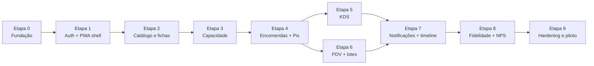

# 09 — Checklist de Desenvolvimento do MVP

> **Status:** Etapa 0 concluída em 2026-10-23. Próxima: Etapa 1.
>
> Escopo: o MVP definido em `08-roadmap-metricas-e-riscos.md` (features **Must** de `04-features.md`). Ordem = ordem de execução; cada bloco só começa quando o anterior está "verde".
> Para **cada feature** aplicar também o *Checklist para Nova Feature* da `ESPECIFICACOES-TECNICAS.md` (entidade → repositório → command/query → registro DI → endpoint → testes → ADR → CHANGELOG).

Legenda de responsáveis: **BE** back-end, **FE** front-end, **DB** banco, **OPS** infra/CI, **PO** produto/negócio.

---

## Etapa 0 — Fundação (OPS / BE / FE)

### Repositório e solução
- [x] `git init`, `.gitignore` (.NET + Node), `.editorconfig`, `README.md` apontando para `docs/`
- [x] Solução `DoceFlow.sln` com projetos `src/Api`, `src/Application`, `src/Domain`, `src/Infrastructure`, `src/Common`
- [x] Projetos de teste `tests/Unit`, `tests/Integration`, `tests/Functional`
- [x] `Directory.Build.props`: `Nullable`, `ImplicitUsings`, `TreatWarningsAsErrors`, Roslynator
- [x] Pacotes: Dapper, FluentValidation, FluentResults, Polly, Serilog (+ sinks), BCrypt.Net, Microsoft.Data.SqlClient, SignalR, Asp.Versioning
- [x] Pacotes de teste: xUnit, NSubstitute, FluentAssertions, Bogus, Mvc.Testing, coverlet

### Base da arquitetura (spec §3, §7, §12, §16, §17)
- [x] `ICommand`, `ICommand<T>`, `IQuery<T>`, `ICommandHandler`, `IQueryHandler`, `IDispatcher`, `Dispatcher`
- [x] `CommandResult`, `PagedQuery`, `PagedResult<T>`, `PagedQueryValidator<T>`
- [x] `Errors` (Validation, NotFound, Conflict, **CapacidadeIndisponivel**, **Pagamento**) e `ResultExtensions.ToIResult()` com mapeamento 422/404/409/402
- [x] `ExceptionHandlingMiddleware` (RFC 7807, `traceId`, 499 em cancelamento)
- [x] `BaseEntity`, `IDomainEvent`, `ICriticalDomainEvent` (ADR-005), `IEventPublisher`, `IMessageBus`
- [x] `LogEventPublisher` como padrão quando `Messaging:Provider` vazio
- [x] `ISpecification<T>`, `OrderByBuilder`, `IDbConnectionFactory` + `SqlConnectionFactory`
- [x] `Application/DependencyInjection.cs`, `Infrastructure/DependencyInjection.cs`, `Domain/DependencyInjection.cs` (vazios, registro manual)
- [x] Teste "todo handler implementado está registrado no DI" (ADR-003)

### Cross-cutting (spec §18)
- [x] `AddDefaultLogging()` Serilog (console colorido em debug, JSON fora)
- [x] `AddBasicHealthChecks()`: `self`, `sqlserver`; `/health/live`, `/health/ready`, `/health`
- [x] `AddJwtAuthentication()` com segredo via user-secrets / env; `JsonStringEnumConverter`
- [x] Swagger com versionamento `/api/v1`

### Banco e infraestrutura local
- [x] `docker-compose.yml`: `api`, `web`, `db` (SQL Server 2022), `azurite`; profile `broker` com `rabbitmq`
- [x] `Dockerfile` multi-stage para API (usuário não-root) e para `web` (nginx)
- [x] Estratégia de migração SQL: scripts versionados em `Infrastructure/Data/Scripts/V001__*.sql` + runner na subida (ou DbUp)
- [x] `V001__infra.sql`: `tblUsuarios`, `tblOtp`, `tblOutbox`, `tblIdempotencia`, `tblAuditoria`
- [x] `appsettings.Development.json` / `appsettings.Testing.json` (banco `_test`, broker vazio)

### CI
- [x] Pipeline: restore → build → testes Unit → testes Integration (SQL Server em serviço) → cobertura → build de imagens
- [x] Gate: cobertura de `Domain` ≥ 90 % *(tolerante: só avisa enquanto Domain tiver < 50 linhas cobertas)*
- [x] Lint/typecheck do front (`eslint`, `tsc --noEmit`) e `vite build`

**Critério de saída:** `docker compose up` sobe API com `/health/ready` verde e Swagger acessível; CI verde em branch vazia.

> ✅ **Concluída em 2026-10-23** (commit `b2a24d4`). Validado: build sem warnings, 58 testes, stack completo via compose com migração aplicada, CI verde (backend, frontend, imagens), deploy Railway. Ressalvas: solução gerada como `.sln` clássico (SDK 8 do CI não lê `.slnx`); portas do compose parametrizadas via `.env` por conflito local; contrato de tipos em `docs/dev/contrato-etapa-0.md`.

---

## Etapa 1 — Autenticação e PWA shell (BE / FE)

### Back-end
- [ ] Entidade `Usuario` (equipe) com roles `Atendente`, `Confeiteiro`, `Entregador`, `Gerente`, `Admin`; seed de admin
- [ ] `POST /auth/login` (e-mail + senha BCrypt) → JWT com roles
- [ ] Entidade `Cliente`; `POST /clientes/otp` e `POST /clientes/otp/validar` (telefone + OTP 6 dígitos, 5 min, 5 tentativas) → JWT role `Cliente`
- [ ] Envio de OTP via `ICanalNotificacaoStrategy` (impl. `LogNotificacao` nesta etapa)
- [ ] `GET /clientes/me`, `PUT /clientes/me` (nome, aniversário, restrições alimentares, consentimentos LGPD)
- [ ] `V002__auth_clientes.sql`
- [ ] Testes: validators, handlers de OTP (expiração, tentativas), integração de login

### Front-end
- [x] Projeto `web/` com Vite + React 18 + TypeScript; Tailwind; Radix/shadcn; React Router; TanStack Query; Zod + React Hook Form *(feito na Etapa 0; componentes base próprios em vez de shadcn)*
- [x] `vite-plugin-pwa`: `manifest.json` (nome, ícones 192/512 maskable, `display: standalone`, `shortcuts`), service worker com precache do shell *(feito na Etapa 0; ícones são placeholders, falta versão maskable)*
- [x] Layouts: `ClienteLayout` (bottom-nav), `OperacaoLayout` (sidebar + atalhos), `EntregadorLayout` (reservado) com breakpoints *(feito na Etapa 0)*
- [x] Rotas base: `/app`, `/pdv`, `/kds`, `/admin`, `/login`, `/entrar` (OTP) *(feito na Etapa 0; `/login` e `/entrar` são placeholders)*
- [ ] Cliente HTTP com interceptação de JWT, refresh e tratamento de `ProblemDetails` *(parcial na Etapa 0: Bearer + ProblemDetails + Idempotency-Key; falta refresh)*
- [x] Guardas de rota por role *(feito na Etapa 0: `RequireRole`)*
- [ ] Telas: login equipe, login cliente por OTP, perfil do cliente
- [x] Página offline de fallback *(feito na Etapa 0)*
- [ ] Lighthouse PWA ≥ 90 (mobile e desktop) no shell vazio

**Critério de saída:** app instalável no celular e no desktop; cliente entra por OTP; atendente entra por senha e vê `/pdv` vazio.

---

## Etapa 2 — Catálogo, opções e fichas técnicas (BE / FE / PO)

### Domínio
- [ ] `Produto` (`Ativar`, `Desativar`, `DefinirFichaTecnica`, `AdicionarGrupoOpcao`) com `AntecedenciaMinimaHoras`, `CargaProducao`, `Estacao`, alergênicos e tags dietéticas
- [ ] `GrupoOpcao` / `Opcao` com `Min`/`Max`, `Acrescimo`, `CargaExtra` (RN-03)
- [ ] `FichaTecnica` + `ItemFicha` + `Insumo`; `PrecoSugerido()` (RN-04)
- [ ] `ProdutoCompativelComRestricoesSpecification` (RN-05)
- [ ] Eventos: `ProdutoAtivadoEvent`, `FichaTecnicaAtualizadaEvent`

### Application / API
- [ ] Commands: `CreateProduto`, `UpdateProduto`, `AtivarProduto`, `DesativarProduto`, `UpsertGrupoOpcao`, `UpdateFichaTecnica`, `CreateInsumo`, `RegistrarEntradaInsumo`
- [ ] Queries: `GetVitrine` (pública, só ativos, com filtros dietéticos), `GetProdutoDetalhe`, `GetProdutosPaged`, `GetInsumosPaged` (`abaixoDoMinimo`)
- [ ] Endpoints `/catalogo/*`, `/estoque/insumos*` com `RequireAuthorization` por role
- [ ] Upload de foto do produto para blob (Azurite local) com URL pública
- [ ] `V003__catalogo.sql` (produtos, grupos, opções, fichas, itens, insumos, movimentos)
- [ ] Testes: regras de `Min`/`Max`, cálculo de custo e preço sugerido, spec de restrições; integração de vitrine

### Front-end
- [ ] `/app` vitrine responsiva: cards, categorias, busca, filtros dietéticos, alergênicos visíveis (F-101)
- [ ] `/admin/catalogo`: CRUD de produtos, grupos de opção, insumos
- [ ] `/admin/catalogo/:id/ficha-tecnica`: editor com custo em tempo real e preço sugerido com alerta de margem (F-501)
- [ ] Cache `stale-while-revalidate` para `/catalogo/*`; fotos `cache-first`

### Produto / conteúdo
- [ ] Cadastro inicial: ≥ 20 produtos reais, opções do bolo (tamanho, massa, recheio, cobertura), fichas técnicas dos 10 mais vendidos
- [ ] Definir pontos de carga por produto e opção junto com a cozinha (RN-21)

**Critério de saída:** vitrine pública real no celular; gerente cadastra produto com ficha técnica e vê preço sugerido.

---

## Etapa 3 — Capacidade de produção (BE / FE / PO)

- [ ] `CapacidadeDia (Dia, Turno, Estacao)` com `Reservar`, `Liberar`, `Disponivel()`, `ReservaProntaEntrega`, `OverbookingPermitido`, `Bloqueado` (RN-20 a RN-24)
- [ ] `IImpactoCapacidadeStrategy` + `ConfirmarStrategy`, `CancelarStrategy`, `ReagendarStrategy`, `AlterarStrategy` + `ImpactoResolver` (ADR-007)
- [ ] `ICargaProducaoStrategy` por tipo de produto
- [ ] Repositório com `UPDATE ... WHERE Ocupada + @delta <= limite` atômico; índice único `(Dia, Turno, Estacao)`
- [ ] Geração automática de capacidade recorrente por dia da semana + feriados (job na subida / comando `GerarCapacidadePeriodo`)
- [ ] Queries: `GetDisponibilidade(de, ate, carga)` → slots; `GetOcupacaoPeriodo` (gestão)
- [ ] Commands: `UpdateCapacidadeDia`, `BloquearDia`, `AprovarOverbooking` (Gerente)
- [ ] Eventos: `CapacidadeEsgotadaEvent`, `CapacidadeAlteradaEvent`
- [ ] Endpoints `/capacidade*`; `409` com `sugestoes[]` (3 próximos slots)
- [ ] `V004__capacidade.sql`
- [ ] Testes: cada strategy; concorrência (2 reservas simultâneas no último slot → uma falha); sugestões
- [ ] FE `/admin/capacidade`: grade semana × turno × estação, editar/bloquear (F-305)
- [ ] FE componente `CalendarioCapacidade` reutilizável (dias lotados desabilitados, tooltips com turnos)

**Critério de saída:** calendário mostra só datas viáveis para uma carga informada; dois pedidos concorrentes nunca excedem a capacidade.

---

## Etapa 4 — Encomendas, montador e sinal Pix (BE / FE)

### Domínio
- [ ] `Encomenda` com máquina de estados completa (§3.1 de `03-dominio`): `Criar`, `EnviarOrcamento`, `Aceitar`, `RegistrarSinal`, `IniciarProducao`, `AvancarEtapa`, `MarcarPronta`, `RegistrarSaldo`, `Entregar`, `Concluir`, `Cancelar`, `Reagendar`, `AlterarPersonalizacao`
- [ ] `EncomendaItem` (RN-02, RN-03), `Personalizacao` (VO), `JanelaEntrega` (VO), `Dinheiro` (VO)
- [ ] RN-10 (antecedência), RN-11 (sinal ≥ 50 % configurável), RN-15 (sem alterar itens em produção)
- [ ] `EncomendaCancelavelSpecification`, `EncomendaEntregavelSpecification`
- [ ] `IPoliticaEstornoStrategy` → `EstornoPorAntecedencia` (RN-14)
- [ ] Eventos críticos (outbox): `EncomendaConfirmadaEvent`, `EncomendaCanceladaEvent`; demais: `EncomendaCriada`, `OrcamentoEnviado`, `EncomendaReagendada`
- [ ] `Pagamento` (Tipo, Finalidade, Status, TxId, ExpiraEm)

### Pagamentos
- [ ] `IPixGateway` (`CriarCobranca`, `ConsultarCobranca`, `Estornar`) + implementação do provedor escolhido + `FakePixGateway` para dev/testes
- [ ] `POST /webhooks/pix`: validação HMAC, idempotência por `txid`, dispara `ConfirmarPagamento`
- [ ] Polling de fallback para cobranças pendentes (worker, 1 min) — risco #3
- [ ] Outbox: `tblOutbox` na mesma transação + `OutboxWorker` (ADR-005)

### Application / API
- [ ] `SimularOrcamento` (preço + carga, sem persistir), `CreateEncomenda` (cria + reserva provisória? **não**: reserva só na confirmação), `RegistrarSinal`, `CancelarEncomenda`, `ReagendarEncomenda`, `GetEncomenda`, `GetEncomendasPaged`, `GetMinhasEncomendas`
- [ ] Consumer `CapacidadeConsumer`: `EncomendaConfirmada` → `ImpactoResolver` (confirmar); `EncomendaCancelada` → liberar
- [ ] Consumer `EstoqueConsumer`: reservar insumos por ficha técnica (RN-32); liberar no cancelamento
- [ ] Worker `Expiracao`: orçamento 48h, Pix 30 min + 2 lembretes (RN-13)
- [ ] Endpoints `/orcamentos/simular`, `/encomendas*`
- [ ] `V005__encomendas_pagamentos.sql` (+ `rowversion`)
- [ ] Testes: máquina de estados (toda transição inválida falha), política de estorno (3 faixas), webhook duplicado, outbox grava na transação; funcional "criar → pagar sinal → confirmada"

### Front-end
- [ ] `/app/montar-bolo`: montador em SVG por camadas, grupos de opção com `Min`/`Max`, preço em tempo real via `simular` com debounce (F-103)
- [ ] Upload de fotos de referência + mensagem/observações (F-105)
- [ ] Passo de data usando `CalendarioCapacidade` + escolha de turno/janela de retirada (F-104)
- [ ] Confirmação de alergênicos quando conflita com restrições do cliente (RN-05)
- [ ] Tela de pagamento do sinal: QR Pix + copia-e-cola + contador de expiração + atualização por SignalR/polling
- [ ] `/app/encomendas` (lista) e `/app/encomendas/:id` (detalhe, cancelar com preview do estorno)
- [ ] `/admin/encomendas`: lista paginada, filtros por status/data, reagendar, cancelar, aprovar overbooking

**Critério de saída:** cliente monta bolo, escolhe data viável, paga sinal com Pix fake e vê "Confirmada"; capacidade do dia reflete a carga.

---

## Etapa 5 — KDS: fila de produção (BE / FE)

- [ ] `EncomendaEtapa` (etapa, usuário, foto, timestamp); etapas configuráveis por tipo de produto (massa → recheio → montagem → decoração)
- [ ] RN-16: etapa "decorado" exige foto; `EncomendaEtapaAvancadaEvent` → notificação com foto
- [ ] Commands: `IniciarProducao`, `AvancarEtapa` (multipart → blob), `MarcarPronta`
- [ ] Queries: `GetFilaProducao(dia, estacao)` (ordenada por data/hora de entrega, com urgência), `GetPlanoDoDia` (consolida fichas técnicas → lista de insumos e faltas)
- [ ] Endpoints `/producao/*` (role `Confeiteiro`/`Gerente`)
- [ ] SignalR `OperacaoHub` grupo `kds`: nova encomenda confirmada, mudança de status
- [ ] `V006__producao.sql`
- [ ] Testes: fila ordenada corretamente; etapa sem foto falha quando obrigatória; plano do dia soma insumos
- [ ] FE `/kds`: colunas A fazer / Em produção / Pronto por estação, cores por urgência, toque único para avançar (F-301, F-302)
- [ ] FE câmera para foto da etapa (`getUserMedia` / input capture)
- [ ] FE `/kds/plano-do-dia` com lista de insumos e alertas de falta (F-303)
- [ ] FE outbox offline para `AvancarEtapa` (Dexie) com `Idempotency-Key`

**Critério de saída:** encomenda confirmada aparece no KDS em tempo real; confeiteiro avança etapas com foto e marca pronta; tablet sem internet continua marcando etapas e sincroniza depois.

---

## Etapa 6 — PDV, lotes e pronta entrega (BE / FE)

### Domínio
- [ ] `Lote` (`Baixar`, `MarcarUltimasHoras`, `MarcarVencido`, `RegistrarPerda`) com estados (§3.3)
- [ ] `Pedido` com máquina de estados (§3.2): `AdicionarItem`, `AplicarDesconto`, `Fechar`, `ConfirmarPagamento`, `Separar`, `MarcarProntoRetirada`, `Entregar`, `Cancelar`
- [ ] `IDescontoStrategy` → `DescontoQuantidade` (RN-06); resolver via keyed services
- [ ] Baixa FEFO (RN-30) por produto em uma transação; `PedidoPagoEvent` (crítico)
- [ ] `Caixa` (abrir, sangria, suprimento, fechar, conferência)

### Application / API
- [ ] `IdempotencyMiddleware` + `tblIdempotencia` (ADR-008); `Idempotency-Key` obrigatório em `POST /pedidos` vindo do PDV
- [ ] Commands: `CreatePedido`, `ConfirmarPagamentoPedido` (Pix webhook, dinheiro, cartão), `CancelarPedido`, `RetirarPedido` (QR), `RegistrarLote`, `RegistrarPerdaLote`, `AbrirCaixa`, `FecharCaixa`
- [ ] Queries: `GetPedidosPaged`, `GetPedido`, `GetRetiradasDoDia` (encomendas prontas + pedidos prontos), `GetLotesDisponiveis`, `GetCaixaAtual`
- [ ] Worker `ValidadeLotes` (15 min): últimas horas e vencidos; `LoteVencidoEvent` registra perda com custo (RN-31, RN-33)
- [ ] Consumer `EstoqueConsumer`: `PedidoPago` → baixa FEFO
- [ ] Endpoints `/pedidos*`, `/estoque/lotes*`, `/caixa*`
- [ ] SignalR grupo `pdv`: pagamento confirmado, encomenda pronta
- [ ] `V007__pedidos_lotes_caixa.sql` (+ índice único `IdempotencyKey`, `TxId`)
- [ ] Testes: FEFO escolhe lote certo; pedido duplicado por chave devolve a mesma resposta; estoque insuficiente → 409; job de validade; desconto por faixa

### Front-end
- [ ] `/pdv`: grade de produtos com estoque por lote, carrinho, identificar cliente por telefone (F-205), atalhos de teclado (F-201)
- [ ] Pagamento: Pix QR em "tela do cliente" (segunda janela/rota `/pdv/cliente`), dinheiro com troco, cartão (maquininha externa) (F-202)
- [ ] Modo offline: outbox Dexie, banner "offline há X min", bloqueio de Pix offline, conflitos de estoque exibidos (ADR-008)
- [ ] `/pdv/retiradas`: lista do dia + scanner de QR via câmera + cobrança de saldo (F-203)
- [ ] `/pdv/caixa`: abertura, sangria, fechamento (F-204)
- [ ] `/kds/lotes`: registrar produção de pronta entrega com validade; etiqueta imprimível (F-304)
- [ ] `/app` checkout de pronta entrega para retirada (F-102) com Pix
- [ ] QR de retirada na tela do cliente (F-107)

**Critério de saída:** 50 vendas feitas com o PDV offline sincronizam sem duplicar; lote vencido some da vitrine; cliente web compra para retirada e retira por QR.

---

## Etapa 7 — Notificações e timeline pública (BE / FE)

- [ ] `ICanalNotificacaoStrategy`: `WhatsAppGateway` (templates aprovados), `WebPushGateway` (VAPID), `EmailGateway`; cadeia de fallback (F-602)
- [ ] `tblNotificacoes` (histórico, status, template) + preferências por cliente
- [ ] Consumer `NotificacaoConsumer` para: orçamento enviado, sinal confirmado, etapa com foto, pronta (QR), lembretes de Pix, cancelamento/estorno
- [ ] Token opaco de timeline (`TokenTimeline`, revogável); `GET /encomendas/{id}/timeline?token=`
- [ ] Templates WhatsApp submetidos para aprovação (fazer cedo — risco #5)
- [ ] `V008__notificacoes.sql`
- [ ] Testes: fallback em cadeia; consumer idempotente por `EventId`
- [ ] FE: pedido de permissão de push no momento certo (após primeira encomenda), registro de subscription
- [ ] FE `/t/:token` timeline pública sem login com fotos (F-106)
- [ ] FE central de notificações e preferências em `/app/perfil`

**Critério de saída:** cliente recebe no WhatsApp a foto do bolo decorado e o QR de retirada sem ninguém da loja intervir.

---

## Etapa 8 — Fidelidade e NPS (BE / FE)

- [ ] `Cliente.CreditarSelos`, `ResgatarSelos`, níveis Bronze/Prata/Ouro (RN-40, RN-41); `tblMovimentosFidelidade` com expiração em 180 dias
- [ ] `ClienteElegivelPrioridadeSpecification`; `DescontoNivel` como `IDescontoStrategy`
- [ ] Consumer: `PedidoPago` / `EncomendaEntregue` → creditar; `ClienteSubiuDeNivelEvent` → notificação
- [ ] Cupom de aniversário automático D-7 (worker diário) (RN-42)
- [ ] `Avaliacao` (nota, comentário, foto com consentimento) + `GET /relatorios/nps`; disparo de NPS 2h após entrega (F-115)
- [ ] `V009__fidelidade_avaliacoes.sql`
- [ ] Testes: regra de selos, expiração, subida de nível, resgate no PDV
- [ ] FE `/app/fidelidade`: selos, nível, histórico; resgate no checkout e no PDV
- [ ] FE avaliação pós-entrega com foto; galeria na vitrine só com consentimento

**Critério de saída:** compra no PDV credita selos visíveis no app do cliente em segundos; avaliação com foto chega ao relatório de NPS.

---

## Etapa 9 — Relatórios mínimos, hardening e piloto (BE / FE / OPS / PO)

### Relatórios (F-505, mínimo do MVP)
- [ ] `/relatorios/vendas` (por dia, canal, produto), `/relatorios/desperdicio` (perdas por lote/motivo), `/relatorios/ocupacao` (estimado vs real por produto, risco #2), `/relatorios/nps`
- [ ] FE `/admin/relatorios` com filtros de período e exportação CSV

### Segurança e LGPD (F-606)
- [ ] Rate limit em OTP, login e webhooks
- [ ] CORS restrito; headers de segurança; HTTPS obrigatório
- [ ] `Cliente.Anonimizar()` + endpoints de exportação e exclusão de dados
- [ ] URLs assinadas e expiráveis para fotos de produção
- [ ] Auditoria de mudanças de preço, status, capacidade (`tblAuditoria`)
- [ ] Segredos fora do repositório (user-secrets, env, Key Vault)

### Qualidade
- [ ] Cobertura `Domain` ≥ 90 %; testes funcionais dos 3 fluxos-chave (encomenda, PDV offline, lote)
- [ ] Teste de carga leve: 50 req/s em `/catalogo/vitrine` e `/capacidade`
- [ ] Lighthouse PWA ≥ 90 em `/app`, `/pdv`, `/kds`
- [ ] Acessibilidade básica (teclado, contraste, labels) nas telas do cliente e PDV
- [ ] Revisão de todos os `ProblemDetails` em `docs/error-reference.md`
- [ ] Coleção `.http` / Postman em `docs/`

### Operação
- [ ] Ambiente de homologação com broker real (RabbitMQ ou Service Bus) e gateway Pix em sandbox
- [ ] Backup diário do SQL Server + teste de restore
- [ ] Dashboards: ocupação, falhas de webhook, fila de outbox, sincronizações offline
- [ ] Alertas: outbox parada > 5 min, webhook com erro, `/health/ready` vermelho
- [ ] `CHANGELOG.md` v0.1.0; ADRs 001–008 revisadas

### Piloto na loja (PO)
- [ ] Treinamento: atendente (PDV, retiradas, caixa), confeiteiro (KDS, lotes, capacidade), gerente (catálogo, relatórios)
- [ ] Tablet na cozinha e PDV instalados como PWA; impressora de etiquetas configurada
- [ ] Capacidade calibrada para as 2 primeiras semanas com margem conservadora
- [ ] Plano de contingência: operar com Pix estático e caderno se a API cair > 30 min
- [ ] Checklist de pronto do MVP (`08-roadmap`, §4) 100 % verde

**Critério de saída:** duas semanas de operação real com ≥ 98 % de encomendas prontas no horário e zero duplicidade de pagamento.

---

## Checklist por feature (aplicar em todas as etapas)

- [ ] Entidade / VO no Domain com regras retornando `Result`
- [ ] Domain Events emitidos nas transições; críticos marcados com `ICriticalDomainEvent`
- [ ] Interface de repositório em `Application/Abstractions/Repositories`
- [ ] Repositório Dapper `sealed` em Infrastructure (whitelist de ordenação se paginado)
- [ ] Command/Query + Handler + Validator no mesmo arquivo em `Application/Features`
- [ ] Handler: persistir → publicar eventos → `ClearDomainEvents()`
- [ ] Registro manual no DI (handler, repositório, strategies keyed)
- [ ] Endpoint Minimal API com validação explícita e `RequireAuthorization` por role
- [ ] Script SQL versionado
- [ ] Testes: entidade (incl. eventos), handler, validator com `TestData` Bogus `pt_BR`; integração do endpoint principal
- [ ] Tela(s) no PWA com estado offline definido (cache ou outbox)
- [ ] Swagger + `.http` atualizados; `CHANGELOG.md`; ADR se houver decisão nova
